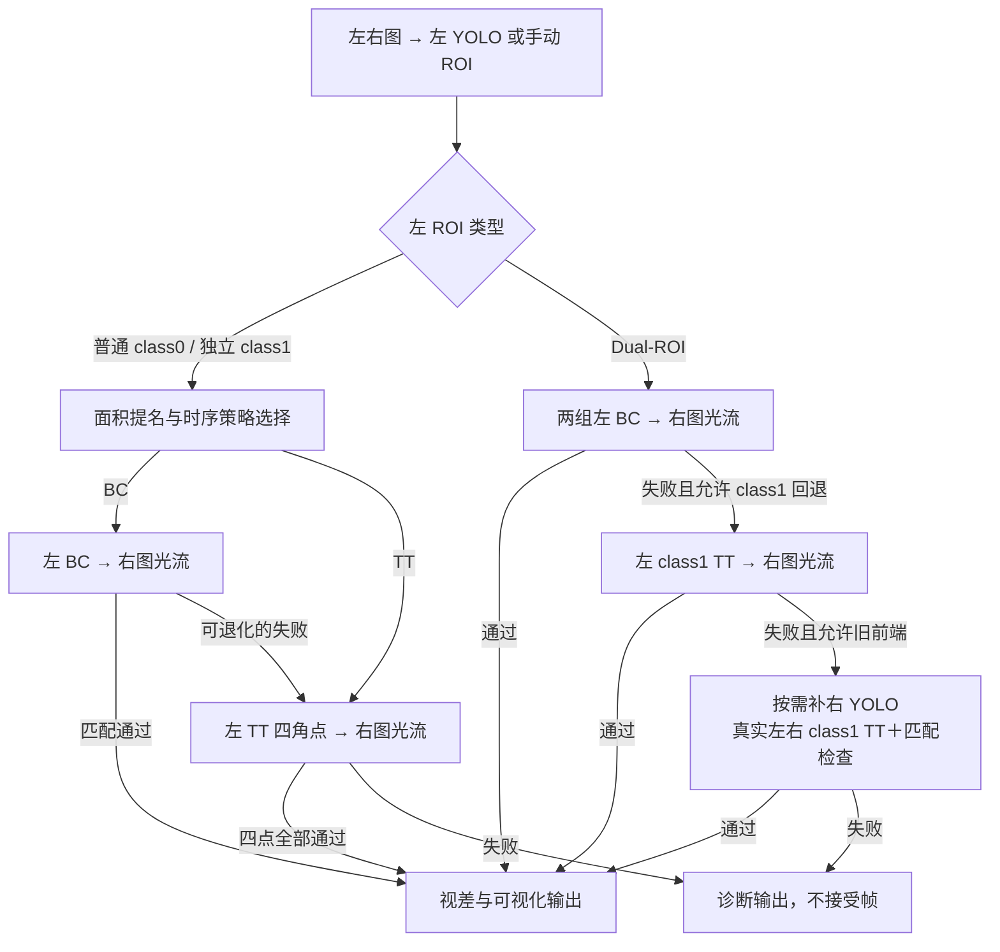

# 完整仅视差策略链

2026-10-13 接入。主配置及 BC 光流示例已开启 `stereo_frontend.disparity_full_chain=true`，补齐直接 TT、普通 BC→TT、独立 class1 BC/TT 和 Dual-ROI 左 TT 退化。旧配置缺省为 false，保持此前入口选择。`method=left_bc_lk` 的名称保留以兼容配置，现在也可驱动完整仅视差链。

## 配置

```json
"stereo_frontend": {
  "method": "left_bc_lk",
  "disparity_only": true,
  "disparity_full_chain": true,
  "dual_roi_flow": true,
  "dual_roi_legacy_fallback": true,
  "roi_pyramid": true,
  "coarse_epipolar_band": true,
  "max_epipolar_error_px": 3.0,
  "on_failure": "reject"
}
```

`disparity_full_chain` 要求 `left_bc_lk` 和 `disparity_only=true`。恢复位姿模式时同时关闭 `disparity_only` 与 `disparity_full_chain`。`on_failure` 控制左目位姿接受，不控制 BC→TT 的视差提取退化。Dual 仍须开启 `dual_roi_flow`，并遵守自身退化开关。

## 分支



普通单 ROI 沿用原策略时序规则；少数迟滞帧原规则还会补充 TT→BC 的向上尝试。每帧只配置一次策略链，成功后按实际胜者反馈粘滞状态。

Dual 的 primary 短路保留：primary 几乎覆盖画幅且允许回退时，先 class1 BC，再左 TT。`tier1_only=true` 只处理 class0；关闭 `class1_fallback_enabled` 不允许 class1 单独接管。左 TT 成功无需右 YOLO；仍失败时，只有原 `dual_roi_legacy_fallback` 和实际右 ROI 提供函数都允许，才走原双侧 TT。

无效图像、无效 ROI、可靠负视差属于终止错误，不通过换提取器或补右检测掩盖。无有效左检测仍由入口跳过。

## 共用匹配与身份

`StereoTrackerDisparity.cpp` 提供共用左侧提取与结果整理，不包含位姿求解。BC/TT 的 `extractMono()` 仅处理左 ROI，右图对应点由现有极线带 NCC、LK 与正反向验证获得。

每次尝试采用对应策略的 ROI padding，恢复全图坐标后匹配。普通 BC→TT 使用同一个单帧 `StereoFlowFrame`；Dual 左 TT 复用已有上下文。ROI 和全图金字塔分别惰性构建，各自最多构建一次，不跨帧复用。

TT 固定要求四个角点全部通过。它使用四点门槛，不受 BC 可配置的更高 `min_matches` 限制；FB、NCC、极线、唯一性、重复点和覆盖等检查保持原标准。BC 的失败点不拼接到 TT 的四角点结果，每条结果都有自身原编号。

独立 class1 使用 class1 参数并记录 `region=1`；退出时恢复提取器参数。仅视差不利用物理尺寸预测右点，不调用 InitialPnP、GPnP 或单目 PnP，不更新位姿缓存，不提交融合视觉观测。`success/gpnp_success/stereo_success` 保持 false，匹配成功看 `disparity_success`。

## 输出与接口

原五参数、六参数以及路径 `process()` 接口保留。仅视差全链开启时，显式提供右 ROI 也使用左侧匹配；Dual 的已提供右 ROI 可供原双侧 TT 退化复用。位姿接口选择沿用此前行为。

CSV 前六列保持不变，统一为：

```text
left_index,left_x,left_y,right_x,right_y,disparity_px,region,original_index,template_index,model_frame,strategy,frame_match_ok
```

`disparity_px=uL-uR` 保留符号。原编号不在过滤后重排；模板身份未知为 -1，模型系为 unresolved。失败帧可能保留部分诊断点，此时 `frame_match_ok=0`，没有点时只写表头，失败原因见日志。

每次 `process()` 只计一帧、写一条日志，路线保留所有尝试，例如 `C1BC:insufficient_stereo_pairs -> C1TT:OK`。耗时累加失败尝试，金字塔构建次数按实际新增次数计。normal 汇总新增视差匹配成功率，位姿成功率仍独立统计。

普通主图仍为 `stereo_fN.png`，TT debug 新增 `tiny_target_stereo/template/flow_status_fN.png` 并保留左 TT 二值图。右侧为灰度匹配结果，不伪造右提取中间图。标题自动换行，明确标记 `frame_match=OK/FAIL` 和 `PnP skipped`；仅视差不画位姿投影或坐标轴。

## 验证

```bash
bash scripts/docker-toolchain.sh cmake -S . -B build-codex-bc-bench -DCMAKE_BUILD_TYPE=Release -DGPNP_BUILD_TESTS=ON
bash scripts/docker-toolchain.sh cmake --build build-codex-bc-bench --target GPNP test_disparity_chain test_stereo_flow test_dual_roi_flow -j4
bash scripts/docker-toolchain.sh ./build-codex-bc-bench/tests/test_disparity_chain
bash scripts/docker-toolchain.sh ./build-codex-bc-bench/tests/test_stereo_flow
bash scripts/docker-toolchain.sh ./build-codex-bc-bench/tests/test_dual_roi_flow
bash scripts/docker-toolchain.sh env ST_CHAIN_EXPERIMENT=1 ./build-codex-bc-bench/tests/test_disparity_chain
```

最后一条生成尺寸／视差／垂直偏移矩阵和 TT 前端微基准到 `output/disparity_full_chain_experiment/tiny/`。实验结果与限制见 `disparity_full_chain_validation.md`。
