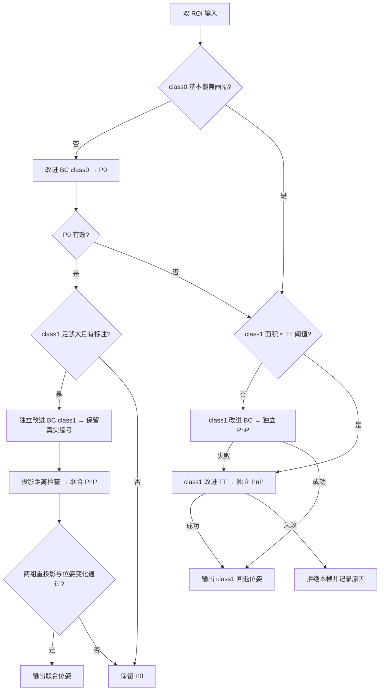

# 单目 DualRoi 的 BC/TT 接入与对照测试（2026-10-20）

本轮完成单目 DualRoi 接入：class0 使用已有改进 BC，class1 使用独立的归一化 BC；微小 class1 直接进入已有改进 TT。联合解算保留物理编号，并检查是否损害原 class0 位姿。双目光流、仅视差链本轮只做兼容回归，尚未推广新的单目前端。

**结论：编号对应与深度尺度有改善；不能认定所有精度、成功率或耗时指标均改善。** class1 独立回退的拒绝率上升，法向误差仍有退步。

## 1. 实现与接口

- 新增 `strategies.dual_roi.mono_robustness`，缺省关闭。独立 class1 BC 实例只在 MonoTracker 的 DualRoi 中使用，不改变普通单 ROI class1 的开关，也不改变双目提取上下文。
- class1 BC 使用四方向归一化、原图边线精化、形状/H 验证及可靠点筛选。标注文件的行顺序成为物理编号，稀疏编号不再压缩成前缀。
- class1 ROI 面积不大于 `close_range.tiny_max_area` 时跳过 BC、直接尝试 TT；当前阈值为 400 px²。较大区域仍按 BC→TT 退化。TT 保留严格图案验收、四方向编号和受限亚像素精化。
- 新 class1 BC 回退与联合解算共用原板图标注三维模型；TT 的四点模型独立保留，不把 TT 四点当成 BC 十点索引。
- 联合匹配仍使用 P0 投影距离门限，但 class0/class1 的可靠物理编号不能被最近邻重新分配。重复编号、非有限点、无效索引与不足的可靠点会被拒绝。
- 联合解算成功后，在**同一组原始 class0 观测**上比较前后重投影；同时检查 class1 重投影、旋转变化和相对平移变化。不通过则保留 P0。
- 补齐回退标志与模板匹配计数，记录完整路由；支持灰度图输入。成功的原生三维轴图也叠加实际使用的角点与编号，保留调试面板。



本轮 TT 用于回退，尚未让四个 TT 参考点参与 BC+TT 联合增强。

## 2. 模型与标定边界

没有修改 400×400 mm 板尺寸、普通 BC 缩放参数、TT 的 295/17 mm 边长或 `[0,0]` 中心偏移。**模型选择发生变化**：新的 DualRoi class1 BC 回退由原 0°模板×0.46 mm/px 模型，改用已有联合解算的板图标注模型。两者原本的 XY 跨度分别约为 22.85×22.76 mm 与 19.86×19.56 mm，因此深度改善包含统一模型的贡献，不能全归因于角点提取。

合成数据真实 class1 中心相对 class0 约为 `[-3.1501, 27.3201] mm`，运行配置仍是用户保留的 `[0,0]`。这使两区域的联合几何并不完全一致。实际测试中，新策略没有采用联合增强，而是保留主区域结果；不能把联合输出数下降解读为未执行 class1 提取。实测偏移与物理尺寸标定仍是后续事项。

另外，源标注的 class1 虚拟包围框约为 19.86×19.56 mm，而 TT 配置仍为 17 mm。这项既有差异仍会影响 TT 深度，不能声称本轮已经消除了所有 class1/TT 切换的尺度误差。

旧联合模型还按 class1 质心重新选循环起点，本数据上为第 7 行。新路径保留标注行序。统计旧联合 class1 误差时，先明确转换回原始标注行，避免把循环编号转换错误计成定位误差。

## 3. 实验设计

- 数据：已有合成集 `tests/data/mono_robustness_20261015`，未重新生成或按测试结果修改数据。图像缓存使用前次实验已验证像素一致的 BMP。
- 完整流程：reference 120 帧、normal_ambiguity 180 帧、oblique_degraded 180 帧，每版本 480 帧，含 YOLO 和实际策略分发。每版本只有 56 个成功输出来自 DualRoi，故不能用总体数字替代 DualRoi 专项分析。
- 固定双 ROI：六个 profile 共 845 案例/版本。其中 505 个联合入口，340 个 class1 回退。回退案例主动提供整幅 primary 以隔离测试 class1 分支，**不是 YOLO 检测成功率实验**。
- 固定案例里，倾角不超过当前 50°约束的有 372 个联合入口、273 个回退案例；其余是约束外压力测试，另行保留在原始统计中。
- 固定 ROI 程序只读取图像和两个框，GT 单独用于事后分析。单目时序关闭；位姿先验保持原配置 50°。
- BC 角点 GT 来自源图人工标注经逐帧 H 投影。TT GT 是源标注包围框四顶点的投影，属于虚拟参考四点，不能声称为真实材料顶点精度。
- 编号异常是几何诊断：比较实际编号与最小距离分配，且误差改善超过 0.5 px 时记异常，不等同于已证明每个编号绝对正确。

## 4. 完整流程结果

| 指标 | 修改前 | 修改后 |
|---|---:|---:|
| 有效位姿 / 480 | 446 | 446 |
| 法向跳变次数 | 91 | 91 |
| 深度跳变次数 | 1 | 1 |

跳变沿用已有分析脚本定义；两版本共有 418 个相邻成功帧对，其法向跳变仍为 91→91，深度跳变为 1→1。没有通过制造失败帧打断相邻关系来宣称跳变改善。

原 22 个 DualRoi_BCJ 输出变为 DualRoi_BC；DualRoi_C1BC 仍为 5 帧。总体深度相对误差中位数约为 2.368%→2.343%，变化较小；法向误差的总体统计没有改善。

## 5. DualRoi 专项：当前 50°约束内

| 分支 | 有效输出（前→后） | 编号异常诊断（前→后） |
|---|---:|---:|
| 联合入口 | 372/372 → 372/372 | 206 → 0 |
| class1 独立回退 | 181/273 → 133/273 | 25 → 0 |

以下仅比较两版本都成功的**相同案例**：

| 分支 | 共同案例 | 角点误差 P95（px） | 深度相对误差中位数 | 法向误差中位数 |
|---|---:|---:|---:|---:|
| 联合入口 | 372 | 13.054 → 2.076 | 0.082% → 0.075% | 0.232° → 0.181° |
| class1 独立回退 | 132 | 5.229 → 4.035 | 22.055% → 4.924% | 7.349° → 22.988° |

**代价不可忽略**：273 个回退案例中，旧版本成功而新版本失败 49 个，新恢复 1 个，净少 48 个。拒绝来自微小区域直接 TT 后的严格图案/方向/几何验收，以及新 BC 的可观测跨度、可靠点与 PnP 校验；不能认定所有被拒的旧输出都错误。

上表比较相同案例，但被采用的点集不同；联合入口 P95 改善主要包含不再采纳错配 class1 点的作用，不能单独当作每个角点提取误差下降的证据。另对 109 个前后均使用 class1 BC 的案例，严格比较相同物理 ID 的 1079 个角点：误差中位数 1.600→1.506 px，P95 为 5.300→4.104 px。

class1 回退的角点误差尾部和深度误差改善，但共同成功案例的法向误差中位数从 7.349°升至 22.988°。小区域中，即使像素误差略有减小，共面 PnP 的倾角仍可能不稳定；不同物理模型和采样偏差也会改变候选。现有结果不足以证明单独的法向估计有提升。

## 6. 独立性能测量

Docker Release，OpenCV 单线程；32 个固定案例、4 轮交替顺序、每轮 5 次测量，共 1280 个计时样本，另有预热。计时排除读图、构造/模板加载、预热与结果写盘；包含 TT 诊断采集和全部尝试的 PnP。

下表限定两版本都成功的相同案例，避免“拒绝更多所以更快”的误读。提取耗时与处理耗时均为中位数；处理 P95 单独列出。

| 分支 | 共同案例数 | 提取（ms，前→后） | 提取+解算等处理（ms，前→后） | 处理 P95（ms，前→后） |
|---|---:|---:|---:|---:|
| 主链/联合入口 | 16 | 3.014 → 2.497 | 5.066 → 2.996 | 33.357 → 35.614 |
| class1 回退 | 7 | 0.289 → 1.445 | 2.346 → 2.140 | 15.311 → 6.585 |

新的 class1 BC 提取更昂贵；主链减少无收益的联合解算后，中位处理时间下降，但主链 P95 略升。回退共同样本仅 7 个，不能推广成所有场景的速度结论，也不能推导相机帧率。上述毫秒数是本机样本统计，均非耗时上限。

## 7. 代表性实际点与三维轴

每图左侧修改前，右侧修改后，均为同一单目图像与 ROI；不是左右相机。点和 R/t 使用 C++ 实际输出，未移动点、翻转位姿或用 GT 替换结果。红轴 +X、绿轴 +Y、蓝轴 −Z up；主区域轴长 100 mm，class1 放大图轴长 5 mm。失败侧不画三维轴。

### primary_preserved

主区域结果保留：旧联合增强改为保留 class0 位姿。 `reference / frame_000039`。


### class1_bc

class1 BC：可靠编号与原板图标注模型。 `reference / frame_000102`。


### class1_tt

class1 TT：展示四个实际输出参考角点与三维轴；旧侧可能使用 BC 十点，两侧点定义不同。 `fast_rotation / frame_000105`。


### rejected_small

拒绝代价示例：旧版本有位姿，新版本拒绝。此例不能被描述为已证实的错误旧位姿。 `oblique_degraded / frame_000090`。


## 8. 验证与复现

- 构建通过。7 类回归共 90 个用例通过，包含新的联合门控消融、class1 模型、微小 TT 路由、状态恢复、BC/TT 编号、双目光流、完整视差链和位姿先验。
- 4 个代表案例原生调试面板成功生成；开关可视化前后的非计时数值字段完全一致。
- 新开关关闭时，120 帧完整序列的位姿、成功状态、策略和点数与冻结基线一致。5 帧的 `fallback` 标志由错误的 false 修正为 true，这是有意修复的状态输出。
- 运行配置会保留原阈值、输入、相机参数和 `[0,0]` 偏移，仅新增 DualRoi 接入开关。

原始 CSV、冻结配置、前后可执行文件、源码摘要、计时和测试日志位于 `output/dual_roi_priority_20261020/`；`verification.json` 记录 SHA256 与核对结果。

```text
docker-toolchain.sh cmake --build build-codex-bc-bench --target GPNP evaluate_mono_dual_roi test_mono_dual_roi test_mono_corner_identity test_tiny_target_robustness -j 3
docker-toolchain.sh python3 scripts/experiment_dual_roi_priority.py before
docker-toolchain.sh python3 scripts/experiment_dual_roi_priority.py after
docker-toolchain.sh python3 scripts/experiment_dual_roi_priority.py run_fixed
docker-toolchain.sh bash scripts/test_dual_roi_priority.sh
docker-toolchain.sh python3 scripts/experiment_dual_roi_priority.py timing
python scripts/analyze_dual_roi_priority.py
python scripts/visualize_dual_roi_priority.py
python scripts/report_dual_roi_priority.py
```

## 9. 后续建议

1. 先实测 class1 中心偏移并核对物理尺寸。当前 `[0,0]` 与合成图不一致，不能靠放宽最近邻门限来掩盖。
2. class1 独立回退仍需专门解决微小目标的可用率与法向精度；不要仅凭更小重投影误差宣称倾角正确。
3. TT 四点参与联合增强需要明确四点的物理定义、尺寸与不确定度，本轮没有直接拼接。
4. 双目推广应另设受控实验：左图新 BC/TT、右图现有 LK、可靠编号贯穿过滤与 GPNP，并检验真实双目和仅视差两种输出。
