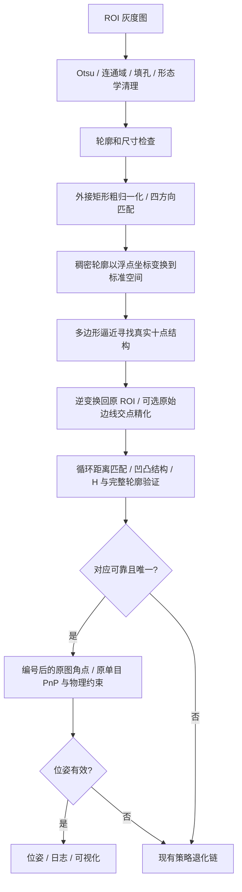

# 单目 BC 先归一化提取：实现与对比实验

本轮实现面向单目 class0 BC。将原先的“24 方向匹配、旋转提取、再次进行身份验证”改为独立的先归一化入口。class1 默认沿用原提取器，双目通过 MonoTracker 上下文隔离保持原入口。

## 算法流程



### 归一化与角点定位

只对 ROI 做一次标准图重采样，其余三个方向使用小图的整 90°旋转。最小外接矩形不是靶板的真实物理四角，因此这是粗归一化，不承诺消除透视。

形状比较使用归一化二值图；角点定位使用实际稠密轮廓变换后的浮点坐标。二者共用同一个变换。避免对 128×128 重采样图重新取像素轮廓引入量化误差、抹去真实顶点。角点拟合在标准空间进行，输出逆变换后仍具有原 ROI 的坐标精度。

搜索多边形逼近参数寻找与模板一致的十点结构，并在点数跨越目标时细分搜索。不会插入虚构顶点来凑足十点。无法得到可靠结构时返回 `normalized_corner_count`。

### 对应关系和验证

0°模板行序定义物理编号。统一轮廓方向后，比较十种循环起点的整体距离，保持一对一及轮廓邻接关系。粗方向证据明确时，优先验证最佳距离候选；否则进入完整循环候选验证。大部分凹凸类型不一致的候选在 H 拟合前被排除，允许少量噪声角点。

H 验证继续检查拟合 RMS、至少 80% 的稳健支持、投影有效性、参考前景可见覆盖和完整前景 IoU，并要求候选有足够的评分差距。H 用于验证和图像对齐，PnP 使用实际观测角点。

### 原图精化

在每条边中部 15%～85% 的范围收集原 ROI 稠密轮廓点，使用稳健直线拟合，以相邻边交点精化角点。检查样本数量、边线残差、交角、位移、图像边界和凹凸关系。精化不可靠时保留该点原观测，整组仍须通过 H 和轮廓检查。

本轮未新增灰度 `cornerSubPix`；精化依据是原始尺寸下的分割轮廓，仍可能存在阈值、模糊、标注偏差。

### 接口与策略链

- `PipelineResult`、ROI 到全图坐标恢复、模板 3D、现有 PnP 及运动门控接口保留。
- 新入口仅由 `MonoTracker` 的上下文激活。双目即便调用 `extractMono()` 也不激活。
- Dual-ROI 主 ROI 使用新 class0 入口；联合解算的 secondary 提取显式设置 class1，结束后恢复 class0，避免将新 class0 前端误用于 class1。
- 普通单 ROI 的失败仍进入 TT；Dual-ROI 继续走其既有后备链。完整 TT 后备策略自身的模板匹配未在本轮替换。
- 调试面板展示 ROI、前景、粗归一化、模板、原图精化前后点及 H 验证编号；日志记录失败原因与阶段耗时。

## 配置

在 `strategies.binary_corner.mono_identity` 中新增：

```json
{
  "enabled": true,
  "frontend": "normalized",
  "refine_original": true,
  "class1_enabled": false
}
```

`frontend="legacy"` 使用上一版 BC 提取加身份验证；`frontend="normalized"` 使用新入口。`refine_original=false` 用于不含边线精化的消融。缺省 `frontend` 保持旧入口；`enabled=false` 关闭整个新身份模块。`class1_enabled=false` 保持 class1 原流程。

## 实验设计与复现

数据集：`tests/data/mono_robustness_20261015`，六段合成序列，共 1,020 帧。标注角点、物理尺寸及位姿由同一个平面投影生成。GT 仅用于离线 ROI 准备和误差统计，不进入 C++ 匹配与位姿算法。

三组共享内参、物理尺寸、策略阈值、PnP 配置，且共同包含 secondary class1 上下文修正：

| 组别 | BC 前端 | 原图精化 |
|---|---|---|
| current | 原有 24 方向提取＋身份验证 | 关闭 |
| normalized | 先归一化、标准空间轮廓提取 | 关闭 |
| refined | 先归一化、标准空间轮廓提取 | 开启 |

角点实验每组 2,040 个 ROI，分别测试 class0 和 class1；比较固定编号误差和最优指派误差，记录拒绝率，并核查 class1 输出坐标一致性。完整可见 class0 单独统计，同时提供三组共同成功帧的比较，避免仅用成功子集掩盖拒绝。

端到端实验每组运行六段序列，逐帧保留成功/失败、策略、旋转矩阵、平移和时序信息。≤30°应用范围和全部压力数据分开报告。

法向跳变：连续成功帧法向夹角 >20°，且比真实法向变化多 >15°。深度跳变：连续成功帧相对深度变化 >30%，且比真实变化多 >20 个百分点。失效间隙后的变化不并入连续帧跳变。

独立耗时实验使用同一解码图与 ROI、一个 OpenCV 线程、每组预热一次并交错运行 12 次；在构建、完整角点实验及位姿实验结束后执行。此耗时仅代表 BC，不代表完整系统 FPS。

```text
python scripts/experiment_mono_normalized.py prepare
docker-toolchain.sh bash scripts/run_mono_normalized_corners.sh
python scripts/experiment_mono_normalized.py corners
python scripts/experiment_mono_normalized.py prepare_poses
docker-toolchain.sh python3 scripts/run_mono_normalized_poses.py --workers 2
python scripts/experiment_mono_normalized.py poses
docker-toolchain.sh bash scripts/run_mono_normalized_timing.sh
```

Windows 主机上使用可运行 OpenCV、NumPy、SciPy 的 Python；C++ 构建与执行经项目 Docker 工具链。原始输出及配置快照位于 `output/mono_normalized_20261016`。

回归验证通过六个 CTest 目标：`test_mono_corner_identity`、`test_mono_pose_prior`、`test_pose_solvers`、`test_extractors`、`test_dual_roi_flow`、`test_disparity_chain`。其中身份/归一化目标包含 12 组测试；新增 Dual-ROI 单目集成测试检查 secondary 的 class1 隔离、联合解算、主 ROI 恢复及可视化。

位姿质量运行可使用最多两个独立进程，输出目录互不共享；独立计时必须等待这些进程结束。运行器检查冻结的二进制与配置哈希，只有当前实验内已经完整写完的序列才允许续用。

<!-- RESULTS:BEGIN -->
## 实验结果

### 标注角点：完整可见 class0

| 版本 | 输出/尝试 | 编号异常诊断帧 | 固定编号误差中位数 / P95（px） | 最大误差（px） | 全部十点≤2px帧数 |
|---|---:|---:|---:|---:|---:|
| current | 918/933 | 0 | 1.117 / 4.250 | 45.346 | 228 |
| normalized | 919/933 | 0 | 1.451 / 3.697 | 10.109 | 170 |
| refined | 919/933 | 0 | 0.610 / 2.538 | 10.109 | 503 |

≤30°且完整可见的 class0 ROI 单独统计：

| 版本 | 输出/尝试 | 固定编号误差中位数 / P95（px） | 全部十点≤2px帧数 |
|---|---:|---:|---:|
| current | 404/411 | 0.969 / 2.947 | 149 |
| normalized | 398/411 | 1.387 / 2.968 | 101 |
| refined | 398/411 | 0.646 / 2.420 | 210 |

本应用角度范围内，新前端的独立 BC 输出数略低，主要是拒绝无法获得可靠十点结构的样本；需结合完整链路的后备策略成功率评估，不能只根据成功点误差宣布全面优于原方案。

三组共同成功的 907 帧：

| 版本 | 固定编号误差中位数 / P95（px） | 最优指派误差 P95（px） |
|---|---:|---:|
| current | 1.122 / 4.274 | 4.274 |
| normalized | 1.452 / 3.659 | 3.659 |
| refined | 0.606 / 2.502 | 2.502 |

编号异常使用固定编号与最优指派差异进行诊断，不等同于逐帧人工认证的准确率。class1 三组坐标一致性已逐条断言检查。

### 独立耗时

| 版本 | class0 调用数 | BC 中位数 / P95（ms） | 平均耗时（ms） |
|---|---:|---:|---:|
| current | 816 | 6.509 / 68.967 | 16.431 |
| normalized | 816 | 2.056 / 18.718 | 4.502 |
| refined | 816 | 2.160 / 21.459 | 5.034 |

三组共同成功的 61 个计时 ROI 另见 `timing_paired.json`，用于排除快速拒绝造成的选择偏差。

| 版本 | 共同成功 ROI 逐次调用中位数 / P95（ms） | 逐 ROI 平均耗时中位数 / P95（ms） |
|---|---:|---:|
| current | 4.016 / 56.006 | 3.513 / 54.198 |
| normalized | 2.049 / 17.117 | 2.017 / 14.780 |
| refined | 2.136 / 18.910 | 2.238 / 17.184 |

### 完整单目链路

| 范围 | 版本 | 成功/总帧 | 法向跳变 | 深度跳变 | 法向误差 P95（°） | 深度相对误差中位数 / P95 |
|---|---|---:|---:|---:|---:|---:|
| all | current | 890/1020 | 43 | 20 | 86.221 | 0.019 / 0.307 |
| tilt_le30 | current | 448/455 | 11 | 1 | 28.383 | 0.014 / 0.208 |
| all | normalized | 894/1020 | 44 | 19 | 86.183 | 0.020 / 0.306 |
| tilt_le30 | normalized | 448/455 | 13 | 1 | 28.132 | 0.013 / 0.208 |
| all | refined | 893/1020 | 42 | 19 | 86.192 | 0.024 / 0.306 |
| tilt_le30 | refined | 448/455 | 9 | 1 | 25.956 | 0.019 / 0.208 |

分序列、策略分布、逐帧误差见 `pose_summary.json`、`pose_frames.json`。全部压力数据中含超过当前 30°先验的视角，其误差不能用于宣称应用范围内精度。

主配置采用 refined。相较 current，它改善了角点精度与法向跳变，但不是所有位姿指标都改善：≤30°范围的深度相对误差中位数约由 1.43% 增至 1.92%，P95 约为 20.75% 且未变。未精化 normalized 组法向跳变反而升至 13 次，因此不作为默认路径。


### 局限

- 数据为同源贴图合成，尚不能替代实拍、曝光变化、反光与遮挡测试。
- 四方向粗归一化仍有透视残差；无法形成可靠十点结构时会拒绝并触发后备策略。
- 原图精化依赖分割边界，不能消除源图模糊、纹理裂缝及标注偏差。
- 现有平面 PnP 的剩余二义性、class1 BC/TT 物理尺度差异不在本轮改动范围内，残余法向/深度跳变需如实保留。
- 保留旧入口用于对照和回退，新入口只作用于单目 class0。
<!-- RESULTS:END -->
