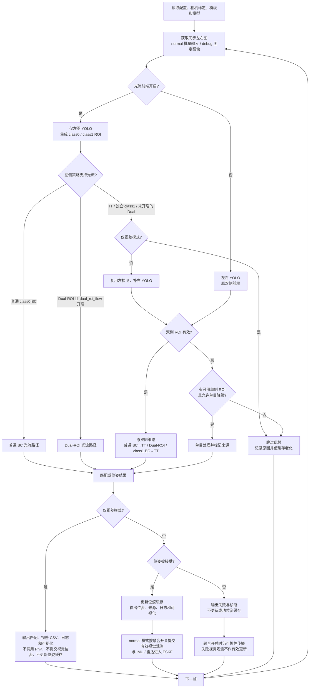
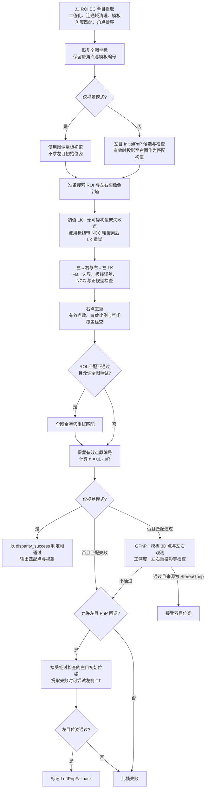
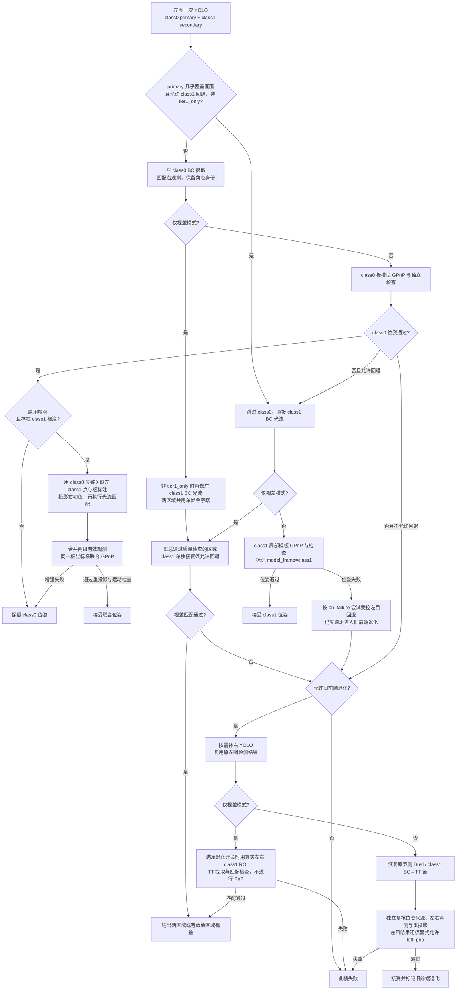

# 当前双目处理流程与分支图

依据 2026-10-13 工作区代码整理。当前实现不包含 AKAZE；特征策略为 BinaryCorner（BC）和 TinyTarget（TT），Dual-ROI 使用 class0/class1 两组 BC 及退化路径。

2026-10-13 后续更新：主配置已启用完整仅视差链。TT、独立 class1 和 BC→TT 不再因策略类型被跳过；Dual 退化先尝试左 TT 光流。新增分支及当前默认流程见 [完整仅视差策略链](disparity_full_chain.md)，下列兼容分支图适用于 `disparity_full_chain=false` 或位姿模式。

## 1. 整体入口

debug 的手动 ROI 可绕过 YOLO。无有效目标时直接跳过。旧 ROI 生成器可能把单侧检测失败归并为空组，单目降级还要求入口确实保留了可用单侧 ROI。

## 2. 普通 BC 光流与共用匹配器

匹配器不靠右图 BC 角点编号配对，而是直接在右图寻找左角点对应观测。极线带允许一定法向偏差，当前容差为 3 px；它不代替相机标定或双目校正。视差保留符号，可靠负视差会提示核对左右输入顺序，不通过取绝对值掩盖问题。

普通 BC 使用自身模板物理尺度。GPnP 使用模板 3D 点与左右图观测；仅视差模式不会把人工图像的视差换成具有物理意义的位姿。

## 3. Dual-ROI 光流分支

`tier1_only=true` 只保留 class0，不执行 class1 增强、primary 短路和 class1 退化。`dual_roi_legacy_fallback` 与 `on_failure=left_pnp` 是两个独立权限：允许补右检测，并不等于允许接受左目位姿。

class0 与增强 class1 采用同一板模型坐标系；单独 class1 回退采用 class1 局部模板坐标系。仅视差时没有 class0 初始位姿，不能借投影建立 class1 的板标注身份，因此相关模板编号可为 -1。TT 原位姿路径使用左目 PnP，不应统计为双目 GPnP 成功。

## 4. 当前配置与实际执行路线

| 项目 | 当前值及含义 |
|---|---|
| 输入 | normal，`data/stereo_crop` 目录批量处理，`max_frames=0` |
| 前端 | `method=left_bc_lk`，Dual-ROI 光流开启 |
| 输出模式 | `disparity_only=true`，只匹配与输出视差 |
| 普通策略提名 | class0 ROI 面积 ≤900 px² 为 TT，否则 BC；实际切换还受 EMA、迟滞及连续确认影响 |
| Dual 触发 | class0 ROI 面积严格 **大于** 2,000,000 px²，且存在 class1 |
| 独立 class1 | class0 缺失时，class1 面积至少 100 px² 才允许生成 ROI；BC/TT 阈值为 400 px² |
| 旧前端退化 | 开启；Dual 匹配失败时可能按需调用右 YOLO |
| 左目位姿回退 | `on_failure=reject`，不允许 |
| 入口单目降级 | `stereo_mono_fallback=false` |

当前数据大部分走：**批量左右图 → 左 YOLO → 普通 BC → 极线带 NCC / LK → 质量过滤 → 视差 CSV、日志和可视化**。完整视差链还支持 TT 和独立 class1；关闭 `disparity_full_chain` 时，原非支持策略仍按兼容行为跳过。

匹配成功看 `disparity_success`；位姿成功看 `success/gpnp_success`；是否为真正双目位姿还要看来源及 `stereo_success`。失败帧保留的部分视差点不代表整帧通过。

normal 输出主可视化，debug 输出中间面板。Dual 保留区域、原角点和模板编号；右图 ROI 框表示搜索范围。仅视差及位姿失败时不画位姿轴或重投影。每帧只计一次帧号、写一条跟踪日志，包含回退尝试耗时。

代码依据：`main.cpp`、`src/detection/RoiGenerator.cpp`、`src/tracker/TrackerBase.cpp`、`src/tracker/StereoTracker.cpp`、`src/tracker/StereoTrackerFlow.cpp`、`src/tracker/StereoTrackerDualFlow.cpp`、`src/matching/StereoFlowMatcher.cpp`。
