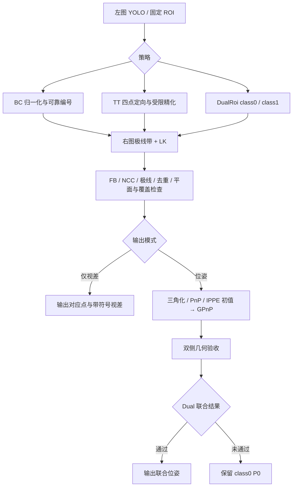

# 双目 P0 接入与对照实验（2026-10-20）

**结论：BC、DualRoi 以及 class1 BC 回退的合成位姿结果有改善；远距离 TT 的双目可用率和法向仍不足，不能作为全面优化成功。新增开关暂默认关闭。**

本轮实现用户批准的第一阶段 P0：双目左图接入改进 BC/TT、真实编号贯通、TT 双目位姿候选、DualRoi 双侧联合验收，并核对模型边界。未实施 P1 的稳健权重和自适应搜索。

## 1. 实现与当前开关

- 新增 `stereo_frontend.robustness`，缺省或 `enabled=false` 使用原双目路径。单目开关独立，当前用户的单目模式、输入、面积阈值、50°单目先验及 class1 偏移 `[0,0]` 未改。
- 使用独立的双目提取器复用归一化 BC、四方向定向、原图精化和可靠点筛选。双目 BC 的最少可靠点独立设为 6；TT 保持四点全部匹配要求，没有把单目八点要求套给 TT。
- 可靠点的模板 ID 贯通光流、过滤、模型查询、GPnP、CSV 与可视化。局部观测索引与物理 ID 分离，过滤后不按前缀重新编号。
- 位姿模式比较双目三角化刚体初值、初始 PnP 和 IPPE 候选。每个候选通过相同的 GPnP、双相机正深度和像素重投影验收；三角化不估计模板尺度。原 GPnP 的射线目标与平移先验未改。
- DualRoi 先保存 class0 的 P0，再尝试 class1 联合解。验收分别比较同一组原始 class0 左右观测的前后残差，同时检查 class1、旋转及相对平移变化；不通过保留 P0。
- class1 BC 回退复用板图标注模型，保留标注行编号；TT 保留独立四点模型，不与十点 BC 直接拼接。原旧前端回退使用的编号缓存单独保留。
- 保留仅视差、负视差终止、按需旧前端回退、共享金字塔和接口。`use_initial_pnp=false` 跳过 PnP/IPPE 初值，仍可使用双目三角化；关闭 `disparity_full_chain` 不会偷偷启用 TT 视差链。
- 左目位姿须 `on_failure=left_pnp` 显式允许，并标记 `LeftPnpFallback`、`stereo_success=false`。仅视差始终不运行位姿候选，不更新位姿缓存。
- 调试图保留实际输出点与真实编号，新增逐点 FB/NCC/极线/平面诊断。左右三维轴使用各自相机投影；蓝色显示 `-Z up`，不修改 R/t。



## 2. 数据与统计边界

| 实验 | 输入与目的 |
|---|---|
| 完整视差链 | 原 `data/stereo_crop` 150 对；同图裁剪生成，视差 100→1 px，垂直偏移约 1–2 px，实际运行左 YOLO |
| 物理位姿 | 96 对独立投影图：普通 BC、远距离 TT、DualRoi、强制 class1 回退各 24 对 |
| 联合验收消融 | 24 个 Dual 案例，真偏移 85 mm、模型故意填 82 mm；比较开关验收 |
| 独立计时 | 20 案例、3 轮 AB/BA/AB、每案例先预热再正式 5 次；每版本 300 个计时样本 |

物理图由同一靶板和同一时刻位姿分别投影至两台相机，使用 K=(900,900,400,400)、60 mm 基线、平行相机、800×800 图像。面内转角覆盖 0–345°，真实总倾角约 3.08–34.97°。设置原图、轻度模糊/亮度差、较强模糊/亮度差与右图噪声三档；本组没有额外遮挡。遮挡与非法输入由专项回归覆盖。

距离范围：BC 1.23–1.77 m，TT 6.98–10.03 m，DualRoi 0.53–0.77 m，class1 回退 0.70–1.00 m。固定 ROI 由投影包围框外扩 5 px 得到，故这是特征与解算对照，不是物理数据上的 YOLO 检测成功率实验。回退组刻意提供全幅 primary，以隔离 class1 路径。

物理实验单独构造一致的 BC/板系模型和 class1 偏移 `[85,0]`，让小白色图案落在 class0 的黑色开口；若重合在大图案白区，class1 会不可见。该实验配置不替换用户的 `[0,0]`。TT 使用包围框宽度定义正方形，原图案宽高约有 0.4% 差异，四点仍是虚拟参考顶点，不能当成四个真实材料角点。

真值只用于离线评分；运行输入仅有图像、ROI、相机与模板参数。两版本关闭时序，未用平滑隐藏跳变。完整视差链因此为 23 个 Dual、90 个 BC、37 个 TT 入口，不能与先前开启 EMA/迟滞时的 23/101/26 分组混用。当前 `mono_pose_prior` 仍只约束 MonoPnP，没有额外给 GPnP 套用 50°硬约束。

## 3. 完整视差链

| 指标 | 原版 | 新版 |
|---|---:|---:|
| 帧通过 | 150/150 | 150/150 |
| 保留点对 | 1492 | 1398 |
| 水平视差 MAE | 0.008500 px | 0.006081 px |
| 水平视差 RMSE | 0.010306 px | 0.008516 px |
| 绝对误差 P95 / 最大 | 0.0175 / 0.0496 px | 0.0172 / 0.0496 px |
| 垂直匹配误差 MAE | 0.012979 px | 0.019027 px |
| PnP 累计耗时 | 0 ms | 0 ms |

两版本均左 YOLO 150 次、右 0 次。新版 12 帧汇总两区域，11 帧保留 class0；小 class1 不再默认参与增强，点数和点集发生变化。水平 MAE 下降包含点集改变的影响，不能推断每一个原点都变好；垂直误差反而略增。最终程序复跑的 150 个视差 CSV 与前一次新版运行逐字节一致。该数据不验证物理深度。

## 4. 物理位姿结果

| 分组 | 原版有效输出 | 新版有效输出 | 原版/新版真正双目输出 |
|---|---:|---:|---:|
| 普通 BC | 20/24 | 24/24 | 20 / 24 |
| 远距离 TT | 24/24 | 7/24 | 0 / 7 |
| DualRoi 入口 | 24/24 | 24/24 | 24 / 24 |
| class1 独立回退 | 23/24 | 24/24 | 23 / 24 |

旧 TT 的 24 个结果来自左图 PnP，原路径来源标志为 `Unspecified`，不是 24 个已验证的双目位姿。新版 7 个结果使用真正双目 GPnP，但不能据此宣称更准确。总输出减少与有效双目输出增加是不同统计口径。

下表仅比较两个版本均有输出的相同案例。深度误差为 `abs(t.z−GT.z)/GT.z`，法向误差为估计与真实法向夹角，不是目标真实倾角。TT 行仍存在左目/双目解算方式不同这一边界。

| 分组 | 共同案例 | 深度误差中位数，前→后 | 法向误差中位数，前→后 | 法向 P95，前→后 |
|---|---:|---:|---:|---:|
| 普通 BC | 20 | 0.712% → 0.360% | 0.645° → 0.580° | 30.997° → 1.153° |
| 远距离 TT | 7 | 4.845% → 3.520% | 52.721° → 55.885° | 65.744° → 65.172° |
| DualRoi 入口 | 24 | 0.408% → 0.116% | 0.330° → 0.143° | 40.510° → 0.277° |
| class1 独立回退 | 23 | 5.439% → 1.123% | 24.607° → 7.314° | 62.792° → 54.819° |

BC 新恢复 4 个旧失败案例；class1 回退新恢复 1 个。TT 少 17 个输出：16 个只保留三对点，1 个未通过严格图案门槛；没有放宽四点要求，也没有伪造第四个匹配。class1 回退法向尾部仍很大，不宜只看中位数。

### 相同物理编号的左图角点

| 分组 | 相同 ID 的观测数 | 像素误差中位数，前→后 | 像素误差 P95，前→后 |
|---|---:|---:|---:|
| 普通 BC | 200 | 1.015 → 0.526 | 3.134 → 0.920 |
| 远距离 TT | 28 | 1.779 → 1.536 | 4.830 → 4.830 |
| DualRoi 入口 | 399 | 0.845 → 0.495 | 2.918 → 2.029 |
| class1 独立回退 | 226 | 0.845 → 1.003 | 2.310 → 2.341 |

该表比较同案例、同类别、同物理 ID 的左提取点，不限定为最终 PnP 使用点。class1 回退的角点误差略增，但位姿有改善，说明本组收益不能全部归因于角点更准；多候选和双目初值也在起作用。本组旧、新版成功案例的编号异常诊断均为零，不能据此量化“修复了多少错误编号”；部分编号保留由专项测试验证。

## 5. Z 方向与法向跳变

只比较两版本共同成功且原帧号相邻的同一批帧对。Z 跳变定义为估计 Z 增量减去真实 Z 增量后，绝对值超过当前真实深度的 5%；法向跳变定义为估计帧间法向转角比真实转角多 10°以上。该定义是本实验诊断门槛，不是硬件精度规格。

| 分组 | 共同相邻帧对 | Z 跳变，前→后 | 法向跳变，前→后 |
|---|---:|---:|---:|
| 普通 BC | 16 | 0 → 0 | 1 → 0 |
| 远距离 TT | 5 | 0 → 0 | 1 → 2 |
| DualRoi 入口 | 23 | 3 → 0 | 8 → 0 |
| class1 独立回退 | 21 | 7 → 4 | 18 → 8 |

DualRoi 的 Z 跳变减少；class1 回退仍有跳变。TT 共同相邻帧对仅 5 个，法向跳变增加，不能因拒绝更多帧而声称更稳定。图中断线表示没有有效输出。


## 6. 联合验收消融

保持图像与真值不变，故意把 class1 的模型偏移从真实 85 mm 写成 82 mm。关验收时 24 帧均接受联合解；开验收时 24 帧均因 `primary_reprojection_worse` 保留 class0。正确模型的原 24 帧两种开关均接受联合，说明不是无条件禁止增强。

| 配置 | 法向误差中位数 | 深度误差中位数 |
|---|---:|---:|
| 开启验收，保留 P0 | 0.151° | 0.115% |
| 关闭验收，接受联合 | 0.578° | 0.240% |

这是有限模型扰动实验，不能替代实际中心偏移测量，也不证明任意错误模型都会被识别。

## 7. 独立耗时

Docker Release、OpenCV 4.5.4、每进程 OpenCV 一线程，使用相同编译优化。按 AB/BA/AB 三轮运行，每案例先预热一次、再正式测量五次。计时不含读图、构造器、模板初始化、CSV 写入、可视化或 YOLO；包含灰度转换、提取、匹配、全部候选解算与内部诊断开销。不是相机端到端 FPS，也不是耗时上限。

仅比较两版本均输出成功的相同计时案例；TT 的旧输出仍是左目 PnP，因此算力工作量不同。提取字段包含匹配，分项中位数不能直接相加得到总中位数。

| 分组 | 共同案例/每版本样本 | 提取+匹配中位数，前→后 | 处理中位数，前→后 | 处理 P95，前→后 |
|---|---:|---:|---:|---:|
| 普通 BC | 4/60 | 6.407 → 6.223 ms | 8.278 → 9.051 ms | 61.637 → 17.211 ms |
| 远距离 TT | 1/15 | 1.664 → 2.194 ms | 2.708 → 4.512 ms | 5.795 → 8.867 ms |
| DualRoi 入口 | 5/75 | 16.113 → 14.454 ms | 19.641 → 19.037 ms | 50.218 → 94.739 ms |
| class1 独立回退 | 5/75 | 1.729 → 3.677 ms | 5.421 → 6.976 ms | 8.303 → 26.374 ms |

最终测量中，DualRoi 处理中位数略降，BC、class1 回退和 TT 更慢；DualRoi 的 P95 反而上升。尾延迟波动明显，不能认定稳定提速，更不能把这些数值换算为完整系统 FPS。主配置保持关闭新开关，避免把实验结果当成已完成部署验证。

## 8. 代表性输出点与三维轴

每图上半为原版，下半为新版；每半中的左右两列是同一双目对。黄点为 class0、绿点为 class1，编号来自程序导出。红/绿轴为 +X/+Y，蓝轴显示 −Z 向板正面；未修改旋转矩阵。左右轴分别经过相机外参投影，不能要求屏幕方向完全一样。图上输出点不表示全都经过新版验收；旧 TT 的右点未参与其左目 PnP。TT 点是算法输出的虚拟矩形顶点，不是人工补画的材料角点。

微小目标和 class1 回退采用放大裁剪，原版/新版可能因策略不同使用不同显示尺度，不能用图上点间距直接估计像素误差。五图是有目的选取的代表，不是随机样本，完整结论以上表为准。

### bc_improved（job 22）

BC：旧版法向误差较大的共同案例，显示新多候选与双目约束后的结果。


### dual_improved（job 57）

DualRoi：旧版退到 class1，新版保留外部大跨度点并完成联合；不能把此图解释为同一组点的单因素对比。


### fallback_improved（job 82）

class1 独立回退：展示新旧共同案例，原点属于统一 class0 坐标系，未强行移到小图案中心。


### tt_normal_limit（job 32）

TT 失败边界：两版本都输出位姿，法向误差仍约 66°；新版确实用了右图，也不能保证倾角正确。


### tt_three_pairs（job 24）

TT 拒绝边界：新版只保留三对点，因此不输出四点位姿。ID 0 的原生诊断 NCC≈0.093，其他三点约 0.976–0.990，未通过低纹理/光度匹配检查。


## 9. 模型核对与剩余风险

用户当前 400×400 mm 板图标注和普通策略的物理模型仍存在差异，未擅自修改实物尺寸：

| 类别 | 板图标注点跨度 | 普通 BC 0°模板跨度 | TT 正方形边长 |
|---|---:|---:|---:|
| class0 | 约 300.37×299.70 mm | 约 293.11×291.93 mm | 295 mm |
| class1 | 约 19.86×19.56 mm | 约 22.85×22.76 mm | 17 mm |

这些跨度对应不同参考几何，不全是靶板实体外边长；但按当前定义直接切换策略确实可能带来尺度偏差。物理实验使用单独一致模型，不能把其实验深度精度直接套给当前实物配置。真实内外参、畸变/校正、同步和实际尺寸还需实拍验证；本轮只覆盖共享 K、平行双目的理想标定条件。

TT 的主要缺陷仍在四个虚拟矩形顶点：某些顶点没有真实纹理支撑，不能保证四点均可追踪；受透视和小目标采样影响，即便四对通过光度/几何门槛，法向也可能很差。当前至少六点的平面过滤会跳过 TT，四点拟合单应再检验同四点不能提供独立证据。下一阶段应研究真实轮廓/纹理支撑、透视四边形或法向可观测性，并单独验收，不能仅放宽匹配门槛。

class1 BC 回退的法向尾部仍大；GPnP 平移先验和残余误差仍可能影响候选择优。三角化初值不是新的硬深度约束。本轮没有修改稳健损失、权重或初值先验强度。

## 10. 验证与产物

相关回归共 **131 项全部通过**，不是整个项目测试总数：

| 专项 | 通过 |
|---|---:|
| `test_disparity_chain` | 11/11 |
| `test_dual_roi_flow` | 41/41 |
| `test_mono_corner_identity` | 16/16 |
| `test_mono_dual_roi` | 4/4 |
| `test_mono_pose_prior` | 8/8 |
| `test_pose_solvers` | 9/9 |
| `test_stereo_flow` | 29/29 |
| `test_tiny_target_robustness` | 13/13 |

- 新增覆盖：BC/TT 真正右图参与、无纹理右图拒绝、class1 BC/TT 与状态恢复、负视差不重试 TT、双侧联合验收、左目回退须显式允许、仅视差无位姿、可视化不改变数值，以及两项配置关闭行为。
- 新开关关闭时，96 个物理案例的全部非计时字段与冻结原版一致。
- 五个代表案例原生可视化开/关的非计时字段一致；当前单目输入两帧与冻结原版的非计时输出一致。
- 新版原生输出包含左右三维轴、实际编号、逐点匹配状态；失败与仅视差不画有效位姿轴。
- 原图、模板和已有配置值未改；主 JSON 只新增默认关闭的 `robustness` 块。

实验目录：`output/stereo_priority_20261020/`，包括冻结程序与源码/头文件、配置与输入哈希、逐点/逐帧 CSV、共同案例统计、同 ID 角点误差、Z 跳变、计时原始样本、开关对照、原生图和报告图。最终程序、源码与验证清单分别由 `verification.json`、`final_source_manifest.json` 记录。

复现现有实验（从项目目录通过 Docker 包装器，不直接在 Windows 运行 ELF）：

```text
bash scripts/docker-toolchain.sh cmake --build build-codex-bc-bench --target GPNP -j4
bash scripts/docker-toolchain.sh bash scripts/finish_stereo_priority.sh
C:/Develop/Conda/envs/DCL/python.exe scripts/analyze_stereo_priority.py physical crop timing
C:/Develop/Conda/envs/DCL/python.exe scripts/visualize_stereo_priority.py
C:/Develop/Conda/envs/DCL/python.exe scripts/report_stereo_priority.py
C:/Develop/Conda/envs/DCL/python.exe scripts/verify_stereo_priority.py
```

首次重新准备独立数据可运行 `experiment_stereo_priority.py prepare`；需保留冻结基线和前一次输入哈希作为对照，不以重新生成的数据冒充旧实验版本。
