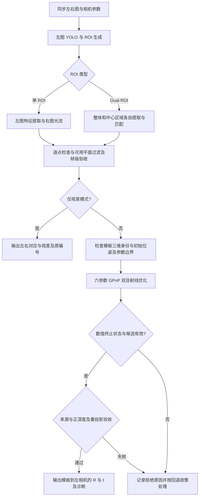
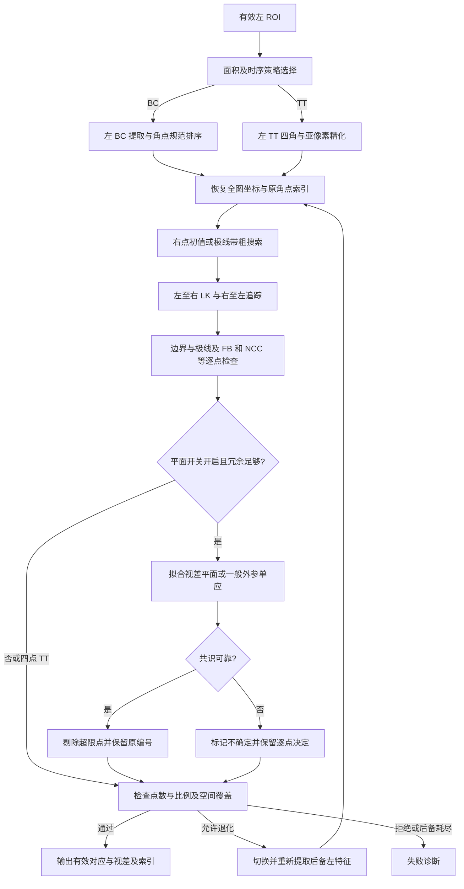
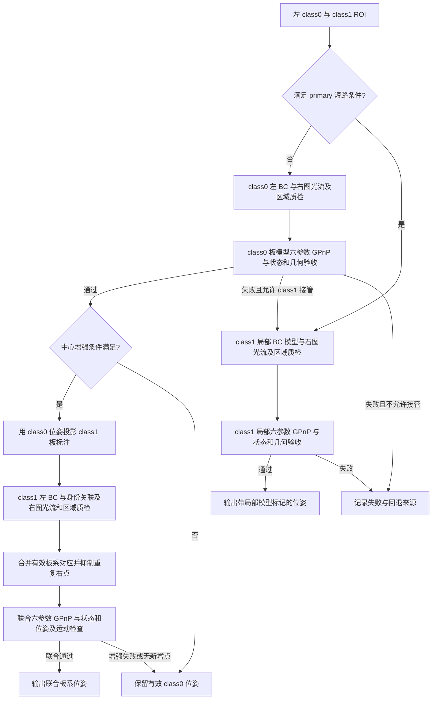

# Steretracker 双目视觉定位算法设计说明

| 项目 | 内容 |
| --- | --- |
| 文档版本 | V1.6 |
| 编制日期 | 2026-10-10 |
| 修订日期 | 2026-10-15 |
| 代码基线 | 本次中心偏移修改基于 HEAD `2f6c3df` 加当前工作区；历史实验仍以各自归档版本为准 |
| 本次实验依据 | SSH 导入的 remote_output 单轮 150 帧；文件指纹见 [分析 provenance.json](C:/D/Codes/NEW_Steretracker-master_COPY/output/remote_stereo_150_analysis/provenance.json) |
| 文档范围 | 双目光流特征对应、稀疏视差、单 ROI／Dual-ROI 策略、GPnP 位姿解算、质量与性能分析；以位姿输出为终点 |
| 实验状态 | 第 8 章保留 SSH 单轮统计，新增本地 Docker 定性匹配图；真实双目位姿仍待开展 |
| 本地优化参考 | 程序、配置、输入和源码哈希见 [优化对照 provenance.json](C:/D/Codes/NEW_Steretracker-master_COPY/output/solver_geometry_optimization/provenance.json) |

## 1 概述

### 1.1 设计目标

本系统面向具有已知形状和物理尺寸的平面合作靶标，利用左图特征提取、右图光流匹配和 GPnP，估计靶标相对于左相机的旋转和平移。本文的算法说明到经质量检查的位姿输出为止。

算法需要解决三个问题：

1. 从左右图像中确定同一物理角点的对应关系，获得稀疏视差。
2. 将左右观测与已知模板三维点构成双目射线约束，联合求解 GPnP 位姿。
3. 在目标尺度变化、近距离局部可见、平面解歧义和视觉间歇失效条件下，提高输出的可靠性与连续性。

本稿以当前主配置启用的“左图 YOLO＋特征提取、右图稀疏光流匹配”为主要前端。BinaryCorner（BC）用于形状角点，TinyTarget（TT）用于小目标与退化；Dual-ROI 分别匹配整体和中心区域，并复用单帧图像金字塔。

算法主线为双目光流匹配后进行 GPnP 位姿解算。本次人工左右图的测试使用仅视差开关，在匹配输出处结束，不调用 PnP、不更新成功位姿缓存。该实验用于验证对应关系与匹配性能，其成功率不代表位姿成功率。

### 1.2 编制依据与实现边界

项目框架依据 [README.md](C:/D/Codes/NEW_Steretracker-master_COPY/README.md) 和 [CLAUDE.md](C:/D/Codes/NEW_Steretracker-master_COPY/CLAUDE.md)，具体计算过程依据当前分支源码核对。参考材料 [《软件算法说明》](C:/Users/90733/Desktop/[总-V2.1]软件算法说明.docx) 用于章节组织、坐标系表述及算法说明格式参考。

参考文档中的 ORB、线特征、单应性绝对位姿及本质矩阵相对位姿，不作为本版本已经实现的主流程。AKAZE 及其旧光流、MAD 视差滤波和独立投影模块仍已移除；当前新增的 StereoFlowMatcher／StereoFlowFrame 服务于 BC／TT，并不是恢复旧 AKAZE 流水线。

本文区分三种内容：

| 类型 | 含义 |
| --- | --- |
| 当前实现 | 已在当前源码中存在的计算和路由 |
| 使用条件与调参要求 | 为正确使用现有算法而需要满足的标定、单位、时序和参数条件 |
| 后续完善项 | 残余异常点处理、位姿接受规则统一和真实设备验证等未完成内容 |

本文所列参数均为当前配置或代码设置，不代表经过实测确定的最优值。

### 1.3 输入与输出

| 类别 | 内容 |
| --- | --- |
| 图像输入 | 同一观测时刻的左、右图像 |
| 几何输入 | 相机内参、双目外参、模板角点与物理尺寸 |
| 检测输入 | YOLO 输出的 class0 整体区域和 class1 中心区域 |
| 仅视差输出 | 全图左右像素对应、`d=uL-uR`、匹配质量、区域与原角点编号；不输出有效位姿 |
| 位姿输出 | 模板到左相机的旋转矩阵 \(R\)、平移向量 \(t\)，平移单位 mm |
| 诊断输出 | 策略名称、角点数量、双目点对数量、视差、求解与回退状态、分阶段耗时 |

## 2 算法基础与坐标约定

### 2.1 坐标系和单位

| 符号 | 定义 |
| --- | --- |
| \(T\) | 模板坐标系，靶标位于 \(Z_T=0\) 平面 |
| \(L\) | 左相机坐标系，光轴为 \(+Z_L\)，图像右方为 \(+X_L\)，图像下方为 \(+Y_L\) |
| \(R_c\) | 右相机坐标系 |
| \((u,v)\) | 全图像素坐标，原点位于图像左上角 |

模型点、基线和平移使用 mm，图像点与视差使用 px，旋转矩阵无量纲。公式中的角度使用 rad；表中以 ° 标明的门槛按角度解释。模板比例若以 m/px 配置，构造三维点时须换算为 mm。

### 2.2 双目几何

针孔相机内参为：

$$
K=
\begin{bmatrix}
f_x&0&c_x\\
0&f_y&c_y\\
0&0&1
\end{bmatrix}.
$$

定义右相机到左相机的刚体变换：

$$
P_L=R_{RL}P_{R_c}+t_{RL}.
$$

因此右相机中心在左相机系中的位置为 \(t_{RL}\)，右相机点坐标为：

$$
P_{R_c}=R_{RL}^{T}(P_L-t_{RL}).
$$

当前主入口使用同一组 \(K\) 表示左右相机，并设置：

$$
R_{RL}=I,\qquad t_{RL}=(B,0,0)^T.
$$

当前代码没有在主流程中执行完整的去畸变和立体校正。水平视差与深度关系成立的条件是输入图像符合上述平行双目针孔模型，或已在输入端完成与求解参数一致的校正。真实硬件若不满足条件，需要先完成标定与参数接入，不能直接用理想模型解释所有像素偏移。

提升位姿效果应先核对左右内参、镜头畸变、安装外参、基线方向与曝光同步。应以已知物理点验证像素投影和左右几何；极线带扩大容差只改善匹配可达性，不能消除错误相机参数产生的系统偏差。

### 2.3 位姿方向

视觉解算输出满足：

$$
P_L=R_{TL}P_T+t_{TL}.
$$

其中 \(t_{TL}\) 表示模板原点在左相机系中的位置，不直接等同于相机在模板系中的位置。相机在模板系中的位置和姿态为：

$$
p_{L/T}=-R_{TL}^{T}t_{TL},\qquad R_{LT}=R_{TL}^{T}.
$$

本说明以模板到左相机的 \(R_{TL},t_{TL}\) 为位姿输出契约。相机在模板系的位置与姿态是上述逆变换的解释，不改变求解器输出方向。优化内部使用三维旋转增量与三维平移；四元数用于诊断和输出，其不同存储顺序见第 5.4 节。

### 2.4 坐标恢复与适用边界

提取器首先产生 ROI 局部坐标，匹配器接收全图坐标。左提取点必须加回 ROI 原点；共用搜索裁剪须同时平移左右坐标和相机主点，并在返回时恢复全图坐标。不同 ROI 原点不能直接相减得到视差。

默认平行双目有效视差为正。匹配器不对负视差取绝对值；多对可靠负视差会提示检查左右输入顺序。一般旋转外参使用极线约束，水平分量仍可记录为 \(u_L-u_R\)，但不能直接套用平行双目的深度公式。

极线带允许一定法向偏差，只是匹配容差，不替代去畸变、立体校正或准确外参。仅视差仍需要相机几何用于极线检查，但不使用靶标物理尺度求位姿。本次左右图由同一原图裁剪和平移生成，提供像素视差真值，不构成物理基线与深度的一致性验证。

### 2.5 实际模板与角点标注

下图使用当前配置中的真实文件绘制：板图为 data/clean_target2.png，橙色编号来自 class0_points.txt，绿色编号来自 class1_points.txt；中心局部放大仅用于看清标注。


两组均按自己的 0–9 编号，不能仅凭相同数字认定为同一个模板点。板图原尺寸为 753×756 px，配置物理尺寸为 400×400 mm。中心放大图不是另一个已统一原点的物方模型。


方向模板直接取自 data/NewMuBan(reordered)，共 24 幅 50×50 px 图，角度从 0° 到 345°、间隔 15°。图中仅为显示放大，算法仍使用原文件。BC 用形状重叠选择方向并建立角点对应；TT 用它判断方向，但输出的是外接矩形四角，不是十个轮廓角点。

板模型、普通 BC 模型和 TT 模型的原点及尺度仍按原实现保留。本节展示外观与身份，不将它们改成同一个坐标系。

## 3 总体算法流程

### 3.1 双目光流总体流程

双目图像进入后，只对左图执行一次 YOLO，依据左侧检测建立 ROI 并选择特征策略。在左 ROI 提取角点、恢复全图坐标后，以右图灰度信息进行极线带搜索与金字塔光流匹配。经过逐点和帧级质量检查，具备模板三维身份的 BC 对应进入 InitialPnP／GPnP，最终输出通过位姿检查的旋转和平移。



本图概括 BC 与 Dual-ROI 的 GPnP 主线，单 ROI 和 Dual-ROI 的具体步骤分别见第 3.3、3.4 节。小目标 TT 光流当前用于视差验证，其 GPnP 接入边界见第 5.1 节。人工左右图实验在“有效左右对应”处结束，保留视差、日志和匹配图。

### 3.2 ROI 与面积策略

YOLO 中 class0 表示整体，class1 表示中心区域。新前端不要求右 YOLO 框存在；右搜索区域由左 ROI、允许视差及匹配边界推导。

| 左侧条件 | 当前选择 |
|---|---|
| class0 有效，面积不大于 `tiny_max_area` | 面积提名 TT |
| class0 有效，面积超过 `tiny_max_area` | 面积提名 BC，后备 TT |
| class0 面积严格大于 `dual_trigger_area`，且 class1 有效 | Dual-ROI |
| class0 缺失，class1 满足近距离回退条件 | 独立 class1 ROI，按 class1 专用阈值提名 BC／TT |
| 无有效左 ROI | 跳过；不通过复制检测框伪造目标 |

当前普通阈值为 2,000 px²，Dual 阈值为 18,000 px²；独立 class1 的最小面积为 100 px²，BC／TT 分界为 400 px²。普通分档使用 padding 前的左 ROI 面积；Dual 触发使用 ROI 生成器的 class0 面积，并要求有效 class1。面积不直接对应固定物理距离。

单 ROI 策略结合面积 EMA、迟滞、连续确认及成功策略反馈，减少目标面积在分界附近变化时的 BC／TT 切换抖动。完整视差链在提取或匹配失败时尝试后备策略，少数迟滞帧还会补充 TT→BC 的向上尝试。每帧只配置一次策略状态，不因重试重复更新 EMA 或帧号。

仅视差成功可以更新策略状态，但不刷新成功位姿缓存。Dual 还要求有效 class1 检测，普通 BC／TT 的迟滞不能防止 class1 丢检引起的 Dual 退出；本次第 10 帧即属于检测分支变化。

### 3.3 单 ROI 双目光流流程

单 ROI 可以来自 class0 整体目标或独立 class1 中心目标。依据面积及时序状态选择左 BC 或左 TT，在各自 padding 后的 ROI 中提取角点；角点恢复全图坐标后，交给同一双目匹配器获取真实右图观测。



普通 BC 的左模板编号用于建立物方点对应；有效左目初值可提前生成右点初值，匹配通过后用真实左右观测进入 GPnP。没有可靠初值时，极线带粗搜索为光流提供初始化，投影点始终不能代替右图观测。

完整视差链允许 BC→TT，复用当前图像对的金字塔。每次后备仍须重新提取自己的左点，BC 失败点与 TT 四点不混合；TT 要求四点全部通过，不降低其他质量门槛。流程中的后备列表有界，每个提取器只尝试一次；无效输入或可靠负视差直接终止，避免反复重试。

匹配结果保留原角点编号和区域编号，失败帧即使保留部分点也不计为匹配成功。TT／独立 class1 的光流链路已覆盖视差输出，但不能据此认定所有这些分支都已接入 GPnP。

### 3.4 Dual-ROI 双目光流流程

Dual-ROI 使用左 YOLO 给出的整体 primary（class0）和中心 secondary（class1）。两区域分别在左图提取 BC，在右图通过光流获得对应，并共享当前图像对的金字塔。为了联合解算，两组点必须关联到同一板坐标系。



class0 解 \(P_0\) 通过检查后，用它将板模型中的中心标注投影到左图，再与左 class1 BC 观测一对一关联。右点通过图像光流取得；中心有效点增加时才尝试联合 GPnP。中心提取、关联、匹配或联合解失败，均保留已经接受的 class0 解，不能用增强失败覆盖有效结果。

primary 的宽高均达到画幅的 `primary_span_ratio`，且允许 class1 回退、未开启 `tier1_only` 时，跳过整体区域，进入中心局部链。`tier1_only=true` 只执行 class0，不做中心增强、短路或 class1 接管。模型统一配置开启时，两类模型都在 PnP 前放入 class0 坐标系；区域编号仍保留 class0／class1 身份，不能与模型坐标系混淆。

人工左右图的视差实验直接匹配两区域并汇总通过质检的点，不依赖 \(P_0\) 或板系身份关联。整体失败时，允许的 class1 BC／TT 光流退化承担视差输出；无效输入或可靠负视差终止。此时 `DualRoi_BCJ` 仅表示两区域匹配结果，不表示已求联合位姿。

## 4 双目获得视差的算法设计

### 4.1 稀疏视差与坐标恢复

对左提取点和真实右图观测定义：

$$
p_{L,i}=(u_{L,i},v_{L,i}),\qquad p_{R,i}=(u_{R,i},v_{R,i}),\qquad d_i=u_{L,i}-u_{R,i}.
$$

若左右点来自不同局部 ROI，必须恢复：

$$
u_L=u'_L+x_L,\quad v_L=v'_L+y_L,\quad
u_R=u'_R+x_R,\quad v_R=v'_R+y_R,
$$

$$
d=(u'_L-u'_R)+(x_L-x_R).
$$

光流路径使用全图灰度与全图点坐标，统一以 \(u_L-u_R\) 记录 `disparity`、`dx_filtered` 和 CSV 视差。匹配索引表示图像对应，模板三维身份还需另行建立。

### 4.2 BinaryCorner 左图提取

BC 利用平面靶标的二值形状和规范角点序建立模板对应关系。

1. 对灰度 ROI 执行 Otsu 二值化，得到目标前景候选。
2. 选择主要连通区域，结合触边情况、面积占优和边界覆盖率，降低背景残片被误选的概率。
3. 使用外轮廓填充孔洞，并按闭运算、开运算顺序平滑边界。
4. 将形状裁剪并归一化，对多角度模板计算交并比：
   $$
   \operatorname{IoU}(A,B)=\frac{|A\cap B|}{|A\cup B|}.
   $$
   选择最高 IoU 的模板，取得离散方向。
5. 按模板方向旋转原始 Otsu 二值图，使形状回到规范方向。旋转采用最近邻插值，并通过隔离边界和连通区域选择避免旋转填充区域与目标粘连。
6. 对回正后的目标再次进行区域清理，提取最大外轮廓。
7. 使用 `approxPolyDP` 逼近轮廓，在轮廓周长的 \(0.001\sim0.05\) 范围内搜索简化参数，当前最多搜索 16 次。
8. 若角点数量仍偏离目标值，尝试删除转向角较小的近共线顶点，或在轮廓偏离拟合弦最明显的位置插入顶点。
9. 将角点逆旋转回原 ROI，恢复提取尺度，并按几何规则进行规范排序。

规范排序使用中心到角点的方向，将正上方作为参考方向，选择一致起点和遍历顺序。目标角点数由配置确定，当前为 10。

角点数修复用于减少轮廓简化导致的缺点和多点，但数量正确不代表物理编号一定正确。后续仍需通过模板对应、位姿一致性和实验检查确认匹配质量。

光流前端调用 `extractMono()`，只处理左 ROI。它建立左角点及可用模板编号，右点由灰度匹配取得。

形态学核和 ROI padding 需匹配目标的像素尺度。核过大可能合并相邻角点，裁剪过紧会截断轮廓，过宽会引入背景。应结合角点编号图与模板对应检查提取效果，不以数量修复成功作为物理身份正确的证明。


图中十个编号直接取自 0_degrees.txt，未按显示位置重新排序。个别坐标位于 50×50 图像边缘附近或略超边界，这是当前标注值；绘图保留它们，不在此修改模板。方向匹配、回正与逆旋转应维护同一身份链。

### 4.3 TinyTarget 左图提取

TT 适用于难以稳定恢复完整多边形的小目标：

1. 对灰度 ROI 做三次插值放大，当前倍数为 4，并轻度高斯平滑。
2. 执行 Otsu、主要连通区域选择、填洞和闭开运算。
3. 使用清理后的形状进行离散角度模板匹配。
4. 通过最小面积外接矩形得到四角，并在放大灰度图上亚像素精化。
5. 根据方向做象限对齐，缩放回原 ROI，再恢复全图坐标。
6. 仅视差调用左 `extractMono()`，四角点交给共用右图匹配器。

插值放大不生成原图缺失的真实细节。最小外接矩形角点也不一定落在不规则目标的真实纹理角点上，因此 TT 不能保证接管任意大目标的 BC 失败场景。TT 光流验证以四个合格对应为验收条件，不调用位姿求解器。

### 4.4 右点初值与极线带粗搜索

仅视差使用同坐标右初值 \(\hat p_R^{(0)}=p_L\)，不依赖物理尺寸或上一帧位姿。位姿模式在有效左目初值存在时，可投影模型点得到右初值：

$$
\hat p_{R,i}=\pi\left(KR_{RL}^{T}(R_0P_{T,i}+t_0-t_{RL})\right).
$$

投影只是初值，最终右观测仍来自图像。没有可靠初值或首次 LK／质量检查失败的点，可执行一次有界粗搜索后重试。ROI→全图回退可能另有一次尝试；不跨帧缓存视差。

令左相机到右相机的外参为：

$$
R'=R_{RL}^{T},\quad t'=-R_{RL}^{T}t_{RL},\quad
F=K^{-T}[t']_\times R'K^{-1}.
$$

右极线为 \(l_R=F[u_L,v_L,1]^T\)。粗搜索沿线遍历允许范围，并在极线法向 \(\pm\epsilon_{\mathrm{epi}}\) 内取候选；不是仅搜索固定图像行。当前 3 px 容差对应七条单位间距采样线。一般旋转外参也使用极线法向；ROI 优化只用于符合平行水平条件的几何。

候选采用归一化相关：

$$
\operatorname{NCC}(A,B)=
\frac{\sum_j(A_j-\bar A)(B_j-\bar B)}
{\sqrt{\sum_j(A_j-\bar A)^2\sum_j(B_j-\bar B)^2}}.
$$

低纹理窗口直接拒绝，避免把几乎恒定的块当成高质量匹配。每个沿线位置保留法向最优值，最佳峰需达到 NCC 门槛，并与足够分离的次峰保持 `uniqueness_margin`。法向上同一相关峰不算独立竞争峰。

水平平行双目、单位间距采样时，一次采样整条灰度带，批量执行 NCC，积分图用于保留右窗口弱纹理检查；左窗口只归一化一次。其他几何或步长使用逐候选计算。

沿线候选上限为 512，法向最多九条；沿线步长大于 1 px 时，对最多四个独立峰做有界局部精查，每峰最多 17 个沿线位置。单点单次搜索 NCC 次数上界为 \((512+68)\times9\)，不是只有 512 次。实际次数及粗搜索时间写入日志。


图中 40 px 视差、1.5 px 垂直偏差和 0.5 px FB 均为说明用数值，不来自第 8 章实验。右点应落在允许的极线带内，往返误差比较的是返回左点与原左点；二者不能混成同一个指标。

### 4.5 金字塔 Lucas–Kanade 匹配

LK 在局部窗口中估计位移 \(\Delta p\)，其光度目标可表示为：

$$
\min_{\Delta p}\sum_{x\in\Omega}
\left[I_L(x)-I_R(x+\Delta p)\right]^2.
$$

图像金字塔从粗到细扩展可处理位移范围，线性化迭代在各层精化。当前窗口为 21×21、最大层级 3、最多 30 次迭代、终止精度 0.01 px、最小特征值阈值 \(10^{-4}\)。光度一致性、局部纹理和初值仍是适用条件。

执行左→右后，再以匹配右点反向追踪到左图，定义：

$$
e_{\mathrm{FB},i}=\|\hat p_{L,i}^{\mathrm{back}}-p_{L,i}\|_2.
$$

FB 小表示局部追踪具有一定可逆性，不直接等于相对真值的位移误差。本地历史实验存在 FB 通过而水平误差较大的点，当前 SSH 实验的过滤结果见第 8.5 节。

### 4.6 逐点与帧级质量检查

若 \(l_R=(a,b,c)^T\)，右观测到极线的距离为：

$$
e_{\mathrm{epi},i}=
\frac{|au_{R,i}+bv_{R,i}+c|}{\sqrt{a^2+b^2}}.
$$

| 层级 | 当前检查 |
|---|---|
| 输入与边界 | 左右灰度有效、尺寸一致、坐标有限，LK 和 NCC 窗口有足够边界 |
| LK | 正反向状态有效及纹理特征值检查 |
| 可逆性 | FB≤1 px |
| 几何 | 极线误差≤3 px；默认水平双目视差范围 0.5–400 px |
| 光度 | 精化点 NCC≥0.8；粗搜索还检查峰差≥0.03 |
| 一对一 | 右点距离小于 2 px 的重复候选按质量去重 |
| 跨点几何 | 当前启用平面过滤；残差门槛 0.25 px、最少 6 点、内点比例至少 0.7、有界 128 个候选 |
| 帧级 | 最少点数、有效比例≥0.6、空间覆盖≥0.25 |

空间覆盖使用有效左点凸包面积与候选左点凸包面积的比值；候选需满足 NCC 边界条件。退化或共线分布不能只靠点数判定。普通 BC 至少四对，位姿模式还需满足 GPnP 最少点数；TT 固定四点全部合格，其余质量标准不降低。

更多点只有在身份正确、空间分布有效时才有助于位姿约束。边界、纹理、FB、极线、NCC、视差、峰唯一性及去重检查降低错误匹配概率，但不构成逐点真值精度证明。BC 的数量修复与 TT 的外接矩形尤其需要检查原编号及对应图；右图诊断应显示灰度光流对应。

跨点几何过滤在逐点质检与右点去重之后执行，要求当前调用的点来自同一个平面目标。水平双目采用：

$$
d(u,v)=au+bv+c,\qquad e_i=|d_i-(au_{L,i}+bv_{L,i}+c)|.
$$

坐标先中心化、归一化，降低大像素坐标的数值条件问题。使用固定局部随机种子抽样，小点集在预算内穷举三点组合。找到多数点支持的候选后，用内点重拟合并复核残差；一般外参采用有界单应候选及左右对称传输残差，要求超过最小模型点数的冗余内点。候选共线、模型无效或缺乏可靠共识时，记录“不确定”，不任意改变已有逐点决定。

超限点标记为 `planar_geometry_outlier`，原编号保留。过滤后重新检查点数、有效比例和空间覆盖。单 ROI 与 Dual 各自区域使用同一规则；四点 TT 不满足最少六点条件，状态为 `insufficient_redundancy`，仍须满足原四点全部通过的要求。

省略 `planar_geometry_filter` 默认关闭，当前主配置显式开启。`planar_error_px` 在水平双目中表示视差平面残差，一般外参中表示对称传输残差，不等同于真值误差。过滤不使用实验真值，也不要求真实倾斜目标具有常量视差。

默认水平双目若出现足够数量的可靠负视差点，返回 `negative_disparity_check_input_order`，不通过取绝对值、换提取器或补右检测掩盖输入顺序问题。一般外参不强行套用水平正视差范围。


图中为突出“中间点被删除后仍保留原编号”，示意剔除编号 2，输出 0、1、3、…、9。实际第 29 帧剔除的是编号 9，见第 8.5、8.6 节。被删除点的模板身份不能由剩余数组位置自动替代。

### 4.7 ROI 金字塔与单帧复用

搜索裁剪由左目标、允许视差、有效初值、LK／NCC 窗口及极线带边界共同确定。左右使用相同裁剪原点，局部主点为：

$$
c'_x=c_x-x_{\mathrm{crop}},\qquad c'_y=c_y-y_{\mathrm{crop}}.
$$

裁剪原点按金字塔层级对齐，返回点恢复为全图坐标。区域占比超过 0.85 或一般旋转外参时使用全图；ROI 检查失败可按开关再尝试全图，重试耗时计入本帧。

`StereoFlowFrame` 只持有当前不可变图像对。普通 BC→TT 和 Dual 两区域可以复用已建金字塔；局部与全图各自惰性构建，所需区域或条件不同则据实计数，不强行复用。`pyramids` 表示本帧新增的左右金字塔对数，不是左右两张分别计数。

ROI 金字塔减少无关像素处理，同帧复用避免后备策略或两区域重复构建，批量 NCC 减少极线带搜索开销。收益依赖 ROI 大小、重试和输入内容，局部失败再走全图可能增加耗时。第 8 章 SSH 结果中，YOLO 在已记录的 YOLO＋跟踪时间里占约 95.48%，但执行设备未记录；匹配阶段加速比例不能直接等同于系统 FPS 提升，性能研究还应覆盖推理和图像输入。

### 4.8 原编号、模板身份与输出

过滤后用 `idx_from_filtered` 连接有效点与原左角点数组；不以保留点数重配模板前缀。Dual 另记区域、区域内原编号与模板编号，合并时恢复全图坐标并抑制跨区域重复右点。

仅视差无需三维身份完整。尤其 Dual class1 没有 class0 位姿用于投影关联时，板模板编号为 -1；这是未建立身份，不是匹配数组错位。位姿模式必须通过明确模型索引取得对应三维点，并检查原始点数及模型数量。

在仅视差测试中，成功匹配输出 `disparity_success=true`，所有位姿成功标志保持 false。失败帧允许保存部分诊断点，但 CSV 的 `frame_match_ok=0`。图中右框表示灰度搜索区域，不能解释为右 YOLO 检测框；仅视差不画位姿轴或位姿重投影。

### 4.9 视差与深度关系

在第 2.2 节的平行双目模型下：

$$
Z_i=\frac{f_xB}{d_i},\qquad
X_i=\frac{u_{L,i}-c_x}{f_x}Z_i,\qquad
Y_i=\frac{v_{L,i}-c_y}{f_y}Z_i.
$$

视差误差对深度的局部敏感度为：

$$
\left|\frac{\partial Z}{\partial d}\right|=\frac{f_xB}{d^2}.
$$

小视差会放大距离不确定性。当前仅视差模式不据人工左右图输出物理深度或 PnP；本公式说明使用条件和误差关系，不将第 8 章的像素误差换算成已经验证的真实距离精度。

## 5 获得视差后的双目位姿联合解算

本章只在位姿模式中执行。获得若干视差并不自动产生有效位姿：还需要可靠图像对应、正确模板三维身份、相机标定和一致物理尺度。当前主配置仅视差，跳过本章全部求解。

### 5.1 物方模型与索引

BC 普通模板使用 0° 模板角点，并按配置的 m/px 比例转为 mm。关闭模型统一配置时，保留以角点集合均值为中心的旧构造：

$$
P_{T,i}=
\begin{bmatrix}
(a_i-\bar a)\,s_p\,1000\\
(b_i-\bar b)\,s_p\,1000\\
0
\end{bmatrix}.
$$

class0、class1 可使用不同的 \(s_p\)。TT 使用四角边长模型。Dual-ROI 使用整板模板图尺寸和整板物理尺寸构造两组点：

$$
P_{T,i}=
\begin{bmatrix}
a_iW_{\mathrm{real}}/W_{\mathrm{img}}-W_{\mathrm{real}}/2\\
b_iH_{\mathrm{real}}/H_{\mathrm{img}}-H_{\mathrm{real}}/2\\
0
\end{bmatrix}.
$$

Dual-ROI 的 class0、class1 标注必须位于同一整板模板图像坐标系。标注本身用于离线定义真实物方点，运行时观测仍由图像提取。

上述构造首先生成各路径的模型点。开启 `template_geometry.enabled` 后，在模型初始化时执行统一放置：分别求每组完整规范模板点集的 XY 包围框中心 \(C_k\)，令人工给定偏移 \(\Delta=(\Delta x,\Delta y,0)^T\) 表示 class1 中心在 class0 模板轴下的位置，则：

$$
P_{0,i}^{\mathrm{class0}}=P_i-C_0,\qquad
P_{0,i}^{\mathrm{class1}}=P_i-C_1+\Delta.
$$

仅重定位 XY，保留物理比例、平面 Z=0、轴方向、角点顺序与编号。中心取完整离线模板的包围框中点，不取当前可见点均值、YOLO 框中心或光流过滤后的点均值。该定义让非对称 BC 的角点均值、TT 矩形中心与 Dual 标注模型使用明确的中心约定。

偏移单位为 mm，按正向模板向右为 +X、向下为 +Y。它是靶板上的固定物理尺寸，不是图像中心差。两组模板须共面、同轴；旋转、厚度和尺度差异不能由两个平移分量修正。Dual 标注原有的板图位置不再叠加一次，而是各组重新以自身中心放置；尺寸换算仍使用现有配置，人工偏移覆盖两组中心的相对位置。

普通 BC／TT、独立 class1、Dual class0、联合模型与 class1 退化链均在求解之前使用统一模型，因此求解输出、初值、缓存及坐标轴自然以 class0 中心为原点，不再对最终平移简单加常量。若从局部位姿换算，等价关系为 \(t_0=t_1-R\Delta\)，并非 \(t_1+\Delta\)。

过滤后的原编号必须通过 `good_matches` 或显式模型表连接到三维点，不采用模型数组前缀代替原身份。Dual class0 的原始角点数须与板模板数一致；该检查在光流过滤之前执行。启用统一时位姿输出标记为 `model_frame=class0`；禁用时保留 Dual 的 `board`、class1 回退的 `class1` 等旧标记。仅视差继续使用 `unresolved`，不声称得到物理坐标系位姿。

模板尺寸须来自实物测量。普通 BC 比例、TT 边长和 Dual 整板尺寸具有不同模型语义，应以同一物理点验证尺度及原点，而不只比较配置值。错误的标定或尺寸会形成系统误差，增加点数与优化迭代不能自动消除。

当前 GPnP 光流主线覆盖普通 class0 BC、Dual 板模型 BC 及其 class1 局部 BC 回退。TT 与独立 class1 的完整光流视差链不等同于全部位姿分支已接入 GPnP；TT 现有位姿求解仍使用左图 PnP，不计入本文的双目 GPnP 成功。

### 5.2 初始位姿与优化启动

`use_initial_pnp=true` 时，普通 BC 根据模板身份执行左目 InitialPnP，使用 RANSAC（300 次、8 px、0.99 置信度）及内点 ITERATIVE 精化。求解器检查有限性、平移深度等条件；新光流路径还独立检查初始左投影，当前均值与单点门槛为 8 px。

有效初值用于预测右观测，并启动 GPnP；初值无效时仍可通过极线粗搜索获得图像对应，不把无效投影作为真实观测。没有外部初值时，GPnP 内部用视差幅值的中位数启动深度：

$$
\tilde d=\operatorname{median}(|d_i|),\qquad
Z_0=\begin{cases}
\operatorname{clamp}(f_xB/\tilde d,50,5000),&\tilde d>1\ \mathrm{px},\\
500,&\text{其他情况},
\end{cases}
$$

并取 \(R_0=I,t_0=(0,0,Z_0)^T\)，单位 mm。内部幅值计算只是数值启动，不授权负视差或左右反置，光流在进入求解器前拒绝可靠负视差。

深度初值的截断范围不是系统已验证的测距范围。仅视差不会调用这些初始化步骤，也不会用物理模板尺寸预测右点。

有效 InitialPnP 为平面目标提供优化启动，左右射线共同约束最终位姿。初值错误可能使固定平移正则限制结果，因此应同时记录初值质量、残差和最终重投影，并通过真实旋转、平移真值检验效果；优化代价下降不能替代真实位姿精度。

### 5.3 双目射线联合约束

由左右全图像素坐标得到单位方向：

$$
\ell_{L,i}=
\frac{K^{-1}[u_{L,i},v_{L,i},1]^T}
{\|K^{-1}[u_{L,i},v_{L,i},1]^T\|},
$$

$$
\ell_{R,i}=R_{RL}
\frac{K^{-1}[u_{R,i},v_{R,i},1]^T}
{\|K^{-1}[u_{R,i},v_{R,i},1]^T\|}.
$$

两条射线在左相机坐标系中的原点为：

$$
o_L=0,\qquad o_R=t_{RL}.
$$

给定位姿，物方点变换为 \(Q_i=RP_{T,i}+t\)。构造两组叉积残差：

$$
r_{L,i}=(Q_i-o_L)\times\ell_{L,i},
$$

$$
r_{R,i}=(Q_i-o_R)\times\ell_{R,i}.
$$

单位射线下，残差模长表示点到观测射线的垂直距离。左右残差分别堆叠进入目标函数，不能先把两组残差向量相加而允许相互抵消。

当前求解器加入相对于初始平移的约束：

$$
r_t=
\begin{bmatrix}
0.5(t_x-t_{0x})\\
0.5(t_y-t_{0y})\\
2.0(t_z-t_{0z})
\end{bmatrix},
$$

$$
\min_{R,t}
\sum_i\left(\|r_{L,i}\|^2+\|r_{R,i}\|^2\right)+\|r_t\|^2.
$$

该约束抑制平面目标条件下的平移偏离，对深度方向使用更大的权重，也会使结果依赖初始位姿。当前权重为固定值，尚未由逐点测量协方差推导。


图用 XZ 剖面解释几何：右相机中心为 t_RL，右单位射线须先转到左相机系。模型预测点同时受左右射线约束，虚线表示其偏离；图形间距不代表实验深度或姿态。位姿候选仍需经过数值终止和正深度、重投影验收，不能仅凭两射线接近交汇便宣布成功。

### 5.4 六参数优化、边界与接受检查

GPnP 保留 Eigen Levenberg–Marquardt，旋转改用相对于有效初值的三维增量：

$$
x=[\delta\theta_x,\delta\theta_y,\delta\theta_z,t_x,t_y,t_z]^T,\qquad
R=\operatorname{Exp}([\delta\theta]_\times)R_0.
$$

增量初值为零，小角度指数映射采用稳定级数计算，不再具有四元数尺度冗余或零模长四元数的零残差区域。诊断四元数保留已有 [x,y,z,w] 存储顺序，最终可视化四元数为 [w,x,y,z]，二者不能混读。

优化前检查内参及其逆矩阵的一致性、有效外参、初始旋转及平移、模板和左右点的有限性、索引范围、一对一身份及数组长度。长度不一致直接拒绝，不以最小长度截断。模型或图像点共线／重合、初始模型点左右非正深度也拒绝。没有模板身份的合法图像点按原交集规则处理，未知身份不能伪造。

初值来源以 `Provided`、`InitialPnP`、`DepthGuess` 或 `PreviousPose` 显式记录，不由旋转是否接近单位矩阵推断。原调用方式仍可使用，新调用可传入 `GPnPOptions`，设置来源、预算及像素验收门槛。

雅可比采用中心差分，`ftol/xtol/gtol=1e-8`，默认 `max_function_evaluations=200`。预算对应 Eigen 的 `nfev` 计数；数值雅可比内部的残差调用不等同于该计数。只接受 1–4 类终止状态作为满足数值终止条件的候选，预算耗尽、精度限制和中止均明确拒绝。参数与最终代价须有限，最终代价不能显著超过初值；初值已经接近最优时允许极小代价变化。

优化终止、候选有效和位姿接受分别记录为 `opt_message`、`candidate_valid`、`pose_accepted`。给定左右预测点，像素重投影误差为：

$$
e_{s,i}=\|\hat p_{s,i}-p_{s,i}\|_2,\qquad s\in\{L,R\}.
$$

求解器检查旋转、所用点左右正深度和像素重投影。光流调用显式采用左右平均不超过 3 px、最大单点不超过 8 px，并保留跟踪器独立复核；普通接口缺省求解器门槛为平均／单点 8 px。通过检查的射线解标记 `StereoGpnp`。

仅明确来源为 `InitialPnP` 且通过左目几何检查的初值，才可能作为 `LeftPnpFallback` 返回。跟踪器仍按 `on_failure=reject/left_pnp` 决定接受左目回退，预算耗尽不会由求解器伪装为收敛。日志分别记录求解器接受与帧最终接受，后者还受到来源政策和运动检查限制。

普通 BC 光流尚未统一套用 Dual 的运动门控，TT 的位姿接受规则也尚未与 GPnP 完全统一，见第 5.6 节与第 6 章。

### 5.5 Dual-ROI 板系增广与局部回退

位姿模式的当前光流流程为：

1. 左 class0 BC 建立板模型身份，匹配真实右点并求解经检查的 \(P_0=(R_0,t_0)\)。
2. 在左 class1 ROI 提取 BC 点，用 \(P_0\) 将 class1 板系标注投影到左图：
   $$
   \hat p_j=\pi\left(K(R_0P_{T,j}+t_0)\right).
   $$
3. 在 12 px 门限内按距离贪心一对一关联，建立中心观测到 class1 板模型的身份。
4. 用 \(P_0\) 预测右初值，仍以右图光流取得观测。
5. 合并两个区域的有效对应，去除重复右点；点数增加且满足要求时，以 \(P_0\) 启动联合 GPnP。
6. 联合解经过来源、左右重投影、正深度和适用的运动门控；失败或无有效增强时保留 class0 解。

缺少 class1 标注时位姿增广停用。整体失败或 primary 短路时，按开关进入 class1 BC 光流位姿链；统一配置启用后，class1 模型先放到 class0 系再求解，禁止再次补偿输出。TT 光流退化用于视差验证，其位姿边界见第 5.1 节。不同区域目前仍使用统一射线残差，没有完整逐点测量协方差加权。

仅视差不求 \(P_0\)，不投影关联 class1 板标注，只汇总质量通过的两组图像匹配；此时 `DualRoi_BCJ` 表示两区域视差结果，而非联合位姿。允许 class1 单独接管和 TT 退化由第 3.4 节的开关控制。

### 5.6 时序位姿一致性

位姿通过接受检查后，才能更新成功缓存；视差通过或失败位姿均不能写入该缓存。Dual 可使用有效历史位姿作运动参考，旋转变化为：

$$
\Delta\theta=\arccos\left(\operatorname{clamp}_{[-1,1]}
\frac{\operatorname{tr}(R_kR_{k-1}^{T})-1}{2}\right).
$$

平移门控结合平移差、径向比值，并考虑策略切换与缓存帧龄。class1 缓存有额外保护，但缓存保护不能替代局部模型到板模型的坐标变换。普通 BC 光流尚未采用与 Dual 完全相同的运动门控，相关规则仍需统一和验证。

四元数同号处理与累计旋转角用于减少日志及可视化中的表示跳变，不直接提高物理姿态精度。双目曝光同步、标定和位姿验收仍决定测量可靠性。

## 6 残余异常与后续完善项

本章列出图像匹配、模型及 GPnP 的残余问题与后续验收要求。本地原版实验第 29 帧一个点的 FB=0.628563 px、NCC=0.963796，满足逐点门槛，但水平误差为 0.6371 px。后续平面过滤将其剔除，本次 SSH 结果同样不保留该编号，见第 8.5 节。高 NCC、较小 FB 和准确中位数仍不能保证每个点准确，过滤也不能代替真实位姿验收。

| 完善项 | 验收方向 | 当前边界 |
|---|---|---|
| 残余匹配与 FB 门槛 | 比较误差、保留率、成功率和耗时 | 已增加平面几何过滤；四点 TT 和无可靠共识情况仍缺乏该冗余保护 |
| 普通 BC 与 TT 的位姿接受规则统一 | 明确来源、正深度、重投影及拒绝规则 | 光流 GPnP 有独立检查，其他位姿分支尚未全部一致 |
| 优化器终止与残差判定 | 验证状态、输入边界及位姿几何 | 已区分终止原因、无效参数和接受结果，改为六参数优化；真实精度仍需真值评价 |
| 板模型与 class1 局部模型的坐标统一 | 使用人工中心偏移在 PnP 前统一原点，验证切换 | 已实现共面同轴 XY 偏移；实测中心、尺寸、轴方向仍需校准，不能保证消除所有跳变 |
| 逐点质量驱动的射线权重 | 评估不同区域、尺度和纹理质量对位姿的影响 | 当前射线残差未使用完整逐点测量协方差加权 |
| 普通 BC 运动门控 | 验证跳变拒绝、缓存失效与重新获取 | 尚未与 Dual 使用完全相同的运动检查 |
| 去畸变、双目标定及真实数据验证 | 测量不同距离、姿态、光度差与遮挡下的 GPnP 误差 | 不能由当前裁剪数据与单元测试代替 |

表中区分当前防护及仍待完善的部分。本次补齐人工中心偏移；真实位姿效果仍须使用物理真值评价。

## 7 关键参数与接口

### 7.1 当前场景配置

新增顶层配置如下。主配置已启用，`[0,0]` 为待填写的初始值，不代表已测得同心关系；旧配置省略整个配置节时保持原坐标行为。

```json
"template_geometry": {
  "enabled": true,
  "class1_center_in_class0_mm": [0.0, 0.0]
}
```

偏移必须是两个有限数值。启用却缺少偏移、维数错误或非数值时拒绝启动。修改后须重新创建跟踪器，使模型与缓存使用同一配置；当前没有运行时热更新接口。对应实现与验证见 [中心偏移说明](C:/D/Codes/NEW_Steretracker-master_COPY/docs/template_geometry_offset.md)。该配置不改变图像角点或仅视差输出，也不改变现有物理尺寸。

下表以 2026-10-13 的 [tracker_config.json](C:/D/Codes/NEW_Steretracker-master_COPY/config/tracker_config.json) 与本次保存快照为准。参数是场景设置，不表示已确定的最优值。

| 参数 | 当前值 | 含义 |
|---|---|---|
| `mode / mono_mode` | normal / false | 目录批量双目 |
| `input_system.image.directory_path` | data/stereo_crop | 本次 150 对数据 |
| `input_system.max_frames` | 0 | 处理全部输入 |
| `output.visualize / log_file` | false / true | 正式实验关闭图片写出、保存日志 |
| `camera.fx / fy` | 1370.1816 / 1373.0103 px | 当前内参焦距 |
| `camera.cx / cy` | 516.4761 / 856.0291 px | 当前主点 |
| `camera.baseline_mm` | 60 mm | 相机模型基线 |
| `yolo.model_path / conf_threshold` | yolov8n_p2.onnx / 0.2 | 当前 CPU 检测模型与门槛 |
| `strategies.tiny_max_area` | 2000 px² | 普通 ROI 的 TT／BC 分界 |
| `strategies.dual_trigger_area` | 18000 px² | 严格大于且有有效 class1 才触发 Dual |
| `close_range.class1_min_area / tiny_max_area` | 100 / 400 px² | 独立 class1 的最小面积及 TT／BC 分界 |
| `board_template.gpnp_min_pts / use_initial_pnp` | 4 / true | 位姿模式点数与初值开关；仅视差跳过求解 |
| `board_template.template_real_width_mm / height_mm` | 400 / 400 mm | Dual 板模型尺寸 |
| `binary_corner.corners / kernel_size / corner_scale` | 10 / 3 / 3.0 | 角点数、形态学核与轮廓尺度 |
| `binary_corner.pixel_to_meter_scale_class0 / class1` | 0.0059 / 0.00046 m/px | 普通 BC 模型物理比例 |
| `binary_corner.roi_pad_pixels` | 3 px | BC 上下文 |
| `tiny_target.scale_factor` | 4 | TT 插值倍数 |
| `tiny_target.square_size_m_class0 / class1` | 0.295 / 0.017 m | TT 位姿物方边长 |
| `tiny_target.roi_pad_pixels` | 5 px | TT 上下文 |
| `dual_roi.secondary_expand_pixels` | 0 | 中心额外扩展 |
| `dual_roi.joint_match_gate_px` | 12 px | 位姿模式中心标注投影关联门槛 |
| `dual_roi.primary_span_ratio` | 0.98 | 巨型 primary 短路比例 |
| `dual_roi.class1_fallback_enabled / tier1_only` | true / false | 允许 class1 接管，未限制为 class0 |
| `strategies.stereo_mono_fallback` | false | 入口不做单侧单目降级 |

物理模板参数仍用于模板加载和位姿模型，但仅视差不利用它们求物理深度或右点位姿预测。面积阈值、图像分辨率、ROI padding 和时序设置需共同记录。第 8 章使用 SSH 单轮实验结果；远端配置未附完整快照，本节数值仅作为本地实现参考。

### 7.2 光流与求解配置

| `stereo_frontend` 字段 | 当前有效值 | 来源／含义 |
|---|---|---|
| `method` | left_bc_lk | 主配置；名称保留兼容，完整链也驱动 TT |
| `disparity_only / disparity_full_chain` | true / true | 主配置；完整仅视差链 |
| `dual_roi_flow` | true | 主配置；启用 Dual-ROI 光流 |
| `on_failure` | reject | 主配置；不接受隐式左目位姿回退 |
| `roi_pyramid / coarse_epipolar_band` | true / true | 主配置；局部金字塔和极线带 |
| `max_epipolar_error_px` | 3.0 px | 主配置；覆盖代码默认 1.5 px |
| `roi_fallback_full / roi_max_area_ratio / roi_extra_margin_px` | true / 0.85 / 16 px | 代码默认 |
| `window_size / max_level` | 21 / 3 | 代码默认 |
| `max_iterations / epsilon / min_eigenvalue` | 30 / 0.01 / 1e-4 | 代码默认 |
| `max_fb_error_px` | 1.0 px | 代码默认 |
| `min_disparity_px / max_disparity_px` | 0.5 / 400 px | 代码默认，仅用于水平平行双目范围 |
| `ncc_patch_size / min_ncc / uniqueness_margin` | 11 / 0.8 / 0.03 | 代码默认 |
| `max_search_candidates / coarse_retry` | 512 / true | 代码默认；沿线初采样上限与粗搜索重试 |
| `min_matches / min_valid_ratio / min_coverage_ratio` | 4 / 0.6 / 0.25 | 代码默认；TT 固定四点全通过 |
| `duplicate_distance_px` | 2.0 px | 代码默认；右观测去重 |
| `initial_reprojection_px` | 8.0 px | 代码默认；初始左目检查 |
| `max_mean_reprojection_px / max_point_reprojection_px` | 3.0 / 8.0 px | 代码默认；最终双目独立检查 |
| `planar_geometry_filter` | true | 主配置显式开启，代码默认 false |
| `planar_max_error_px / planar_min_points` | 0.25 px / 6 | 主配置；几何残差与最少冗余点数 |
| `planar_min_inlier_ratio / planar_max_hypotheses` | 0.7 / 128 | 主配置；多数共识与搜索预算 |

省略 `disparity_full_chain` 默认为 false，保留早期普通 BC 仅视差入口限制。开启它要求 `method=left_bc_lk` 且 `disparity_only=true`；恢复位姿须同时关闭 `disparity_only` 与 `disparity_full_chain`。`on_failure` 控制位姿来源接受，不禁止视差提取策略退化。

`dual_roi_flow` 控制两区域光流，`class1_fallback_enabled` 控制中心区域接管，`tier1_only` 限制为整体区域。这些开关的作用独立，不能用其中一个推断其他分支。

### 7.3 策略与位姿时序参数

| 参数 | 当前视觉配置值 | 含义 |
|---|---|---|
| `temporal.area_ema_alpha` | 0.5 | 面积平滑系数 |
| `temporal.stickiness.hold_frames` | 3 帧 | 连续切换确认 |
| `hysteresis_up / down` | 1.25 / 0.8 | 面积迟滞倍率 |
| `max_cache_age_frames` | 30 帧 | 缓存参考最大帧龄 |
| `max_trans_ratio / max_scale_ratio` | 0.35 / 3.0 | 运动门控的平移及径向比值参数 |
| `max_rot_deg` | 15° | 运动门控旋转阈值 |

面积策略稳定见第 3.2 节，位姿缓存和 Dual 运动一致性见第 5.6 节。上述运动门控参数不能解释为所有位姿分支都已执行相同检查。

### 7.4 接口与数据契约

双目光流入口接收左右图像、左 `RoiGroup`、相机参数和可视化开关；主入口按 `prefersLeftStereoFlow()` 的预测结果选择左检测及匹配流程。普通 BC／Dual 的位姿光流调用不预先传入独立右 ROI，右搜索区域由匹配器生成。

光流 `process()` 调用使用左右图像与左 ROI，右 ROI 参数置空以进入对应光流分支。本说明的输出接口为 `PipelineResult` 中的图像对应、匹配状态、模型身份，以及接受后的 `R / t` 和位姿来源。接口验收在 GPnP 输出处结束；日志、CSV、对应图和位姿轴用于复核这一计算链路。仅视差成功不能当作有效位姿读取。

| 数据 | 约束 |
|---|---|
| `pts_left_match / kp_left` | 原左点数组，提取后恢复全图坐标 |
| `pts_left_good / pts_right_good` | 同位置的一对图像观测 |
| `idx_from_filtered` | 有效点对到原左数组索引；不可过滤后重新编号 |
| `good_matches / pose_model_points` | 左点与显式模型身份；进入位姿时必须有效 |
| `flow_regions / flow_original_indices / flow_template_indices` | 区域、区域内原编号、模板编号；未知模板编号 -1 |
| `model_frame` | 板系、class1 局部系或仅视差 unresolved；用于解释模型原点 |
| `disparity_success` | 帧匹配检查是否通过；失败帧可有部分点 |
| `success / gpnp_success / stereo_success` | 位姿接受及真双目来源；仅视差均为 false |
| `pose_source` | StereoGpnp／LeftPnpFallback／Unspecified；须与成功标志和当前路径共同核对 |
| `R / t` | 有效位姿满足模板→左相机变换，平移 mm；不能读取仅视差默认矩阵当作有效位姿 |

完整视差链 CSV 保留前六列并扩展为：

```text
left_index,left_x,left_y,right_x,right_y,disparity_px,region,original_index,template_index,model_frame,strategy,frame_match_ok
```

点坐标为全图，视差保留符号。无点的失败 CSV 可只有表头，原因见日志；有部分点但帧失败时 `frame_match_ok=0`。输出 `stereo_fN.png` 主图，debug 增加 BC／TT／Dual 逐点状态与处理面板，编号、区域和匹配状态可复核。新增平面残差、拒绝原因和聚合计数，CSV 原十二列不变。`[GPnPOptimizer]` 记录终止状态、初值来源、成本及几何验收；`[StereoFrontend]` 增加平面状态、剔除数和耗时。

## 8 实验设计与结果

本章以 SSH 计算后导入的 remote_output 为本次实验依据，分析日期为 2026-10-14。使用与此前相同的 150 对人工左右图，评价策略覆盖、稀疏视差误差和计算耗时。

### 8.1 远端平台、数据与运行记录

| 项目 | 内容 |
|---|---|
| 执行与结果来源 | SSH 远端计算；150 个逐帧 CSV 与一份 tracking_log.txt |
| CPU 型号／线程设置 | |
| GPU 型号／推理执行设备 | |
| 操作系统／容器环境 | |
| 构建模式／编译器 | |
| OpenCV／ONNX Runtime 版本 | |
| 远端程序版本／SHA256 | |
| 来源与数量 | 上升image_00_间隔10 的 150 张源图，生成 150 对左右图 |
| 生成方式 | 左图保留原图 [0,W-d)，右图保留 [d,W)，故 uL-uR=d>0 |
| 视差真值 | 按源序列从 100 px 递减到 1 px，逐帧取本地同数据集 manifest |
| 垂直偏移与光度 | 每帧约 +1–2 px 随机垂直平移，双线性插值与边界复制；无额外光度扰动，种子 42 |
| 日志确认的模式 | normal、双目、directory；disparity_only=1，前端为 LK |
| 模型与门槛 | yolov8n_p2.onnx，置信门槛 0.2；日志未记录执行设备 |
| 相机模型 | fx≈1370.18、fy≈1373.01、cx≈516.476、cy≈856.029 px，baseline=60 mm |
| 面积设置 | 日志确认 TT=2000 px²、class1 TT=400 px²、Dual 触发面积为 18000 px² |
| 平面检查 | 日志确认 BC／Dual 使用 disparity_plane，TT 为 insufficient_redundancy；具体阈值未附远端快照 |
| 重复与预热 | 导入一轮 150 帧；没有多轮重复结果或独立预热记录 |
| 输出 | 150 个 CSV 与日志可核对；可视化开关未附远端配置记录 |

平台与版本的空白项留待填写。第 7 章是本地代码参考配置，不能代替远端运行配置快照；本次远端日志中的配置路径仅表明使用了 config/tracker_config.json，未保存该文件当时的完整内容。

同一数据集的认定依据用户说明和帧结果核对，真值取 [manifest.json](C:/D/Codes/NEW_Steretracker-master_COPY/data/stereo_crop/manifest.json)。该 manifest 与本地优化实验保存的快照逐字节一致，但远端未附图像哈希，因此不把本地图片哈希作为远端运行前后校验。分析阶段对导入日志、CSV 和真值文件计算指纹并确认未改写，见 [分析 provenance.json](C:/D/Codes/NEW_Steretracker-master_COPY/output/remote_stereo_150_analysis/provenance.json)。

数据来自单张源图的裁剪和平移，不是同步双相机实拍。配置基线和模板尺寸不构成本实验的物理深度真值。manifest 的垂直偏移保留三位小数，纵向误差包含记录舍入与插值影响。

### 8.2 指标与统计口径

全部统计使用导入的单轮 150 帧。日志的原始左点总数为 1574，成功帧保留点为 1558。逐点 CSV、StereoFrontend 状态和日志汇总表按数据帧 1–150 一一核对，点数、策略、成功标志及原点编号均一致。

对帧 \(k\) 的点 \(i\)，定义：

$$
e_{d,k,i}=d_{k,i}-d_k^{\mathrm{gt}},\qquad
e_{v,k,i}=(v_{R,k,i}-v_{L,k,i})-\Delta v_k^{\mathrm{gt}}.
$$

$$
\mathrm{MAE}=\frac{1}{N}\sum_{k,i}|e_{d,k,i}|,\qquad
\mathrm{RMSE}=\sqrt{\frac{1}{N}\sum_{k,i}e_{d,k,i}^{2}}.
$$

其中 \(N\) 为成功帧中的保留点总数。MAE 是逐点加权，不是各帧 MAE 的简单平均。误差使用 CSV 的 disparity_px，不以独立舍入后的左右横坐标重新相减代替；纵向误差由导出的左右纵坐标计算。

帧通过率和点保留率分别为：

$$
\eta_f=\frac{N_{\mathrm{frame,pass}}}{N_{\mathrm{frame}}},\qquad
\eta_p=\frac{N_{\mathrm{retained}}}{N_{\mathrm{left,raw}}}.
$$

P95 使用 nearest-rank，即升序第 \(\lceil0.95n\rceil\) 个样本。匹配耗时按实际入口策略分组，本轮没有策略退化，入口和最终策略一致。仅视差下“位姿成功 0”表示 PnP 未执行，不是 150 次位姿解算失败。

将来真实位姿实验须使用统一物理原点和参考系，计算：

$$
e_t=\|t_{\mathrm{est}}-t_{\mathrm{gt}}\|_2,\qquad
e_R=\arccos\left(\operatorname{clamp}_{[-1,1]}
\frac{\operatorname{tr}(R_{\mathrm{est}}R_{\mathrm{gt}}^{T})-1}{2}\right).
$$

当前缺少该真值，重投影或视差误差不能代替真实位姿误差。

### 8.3 三策略覆盖与视差精度

| 入口策略 | 成功帧／帧数 | 匹配点／原始左点 | 点保留率 | 视差 MAE | RMSE | 最大绝对误差 |
|---|---:|---:|---:|---:|---:|---:|
| Dual-ROI | 23／23 | 446／460 | 96.96% | 0.007045 px | 0.008513 px | 0.0203 px |
| BC | 101／101 | 1008／1010 | 99.80% | 0.009550 px | 0.011307 px | 0.0496 px |
| TT | 26／26 | 104／104 | 100% | 0.005140 px | 0.006785 px | 0.0176 px |
| 总体 | **150／150** | **1558／1574** | **98.98%** | **0.008539 px** | **0.010322 px** | **0.0496 px** |

总体逐点绝对误差 P95 为 0.0175 px，1558 个保留点均不超过 0.05 px，没有超过 0.5 px 或 1 px 的点。垂直误差 MAE 为 0.012685 px，最大为 0.152 px；Dual、BC、TT 的垂直 MAE 分别为 0.012361、0.012559、0.015308 px。

最大水平误差来自第 92 帧 BC 原角点 4：真值视差 40 px，测量 39.9504 px，误差 -0.0496 px。这个点的纵向残差约 -0.132 px，说明水平精度不能直接推断二维位移精度。

| 数据帧 | 实际最终策略 |
|---|---|
| 1–9 | DualRoi_BCJ，两区域视差汇总 |
| 10 | BinaryCorner |
| 11–24 | DualRoi_BCJ |
| 25–124 | BinaryCorner |
| 125–150 | TinyTarget |

第 10 帧切换到 BC，日志没有记录 Dual 匹配失败或退化；其原因不能仅由 CSV 定为匹配退化。第 125 帧日志记录 TT 面积提名，原始面积 1482 px²。策略切换同时受面积 EMA 和迟滞影响。

Dual 保留 class0 229 点、class1 217 点，每帧平均 19.39 对；TT 每帧四对。策略退化、全图重试和旧前端回退均为零，每帧仅构建一对金字塔，累计粗搜索尝试 141 次。


图中耗时是单轮逐帧记录，未做三轮平均。不同策略对应不同尺度与点数，不能据组间 MAE 或耗时认定同一输入下某策略更好。DualRoi_BCJ 在本实验不表示已经求得联合位姿。

### 8.4 远端计算耗时

| 策略 | 计时样本数 | 匹配均值 | 中位数 | P95 | 最大值 |
|---|---:|---:|---:|---:|---:|
| Dual-ROI | 23 | 6.291 ms | 5.942 ms | 8.985 ms | 9.558 ms |
| BC | 101 | 3.077 ms | 2.561 ms | 6.171 ms | 7.238 ms |
| TT | 26 | 1.760 ms | 1.710 ms | 2.158 ms | 2.209 ms |
| 全体 | 150 | **3.342 ms** | **2.421 ms** | **7.134 ms** | **9.558 ms** |

| 运行汇总字段 | 远端单轮值 | 口径 |
|---|---:|---|
| 单帧跟踪平均用时 | 9.910587 ms | 跟踪调用中的提取、匹配及 ROI 等 |
| 特征提取平均用时 | 4.892834 ms | 该字段包含匹配，是跟踪时间的细分项 |


### 8.5 平面过滤与点保留诊断

| 检查状态 | 帧数 | 平面剔除点数 |
|---|---:|---:|
| Dual：class0 与 class1 均执行视差平面检查 | 23 | 0 |
| BC：执行视差平面检查 | 101 | 1 |
| TT：insufficient_redundancy，跳过平面检查 | 26 | 0 |
| 总体 | 150 | 1 |

平面检查累计耗时按每帧聚合字段统计：总体均值 0.098367 ms；Dual 为 0.182824 ms，BC 为 0.104174 ms，TT 的冗余判定为 0.001099 ms。这是匹配耗时内部的检查时间，不能据此计算开启／关闭过滤的净开销。

第 29 帧原始左点为 10 个，保留 9 个；CSV 保留原编号 0–8，编号 9 缺失，日志明确记录 planar_rejected=1，帧仍通过。真值为 81 px，保留点视差中位数为 81.0091 px，MAE 为 0.010333 px，最大误差为 0.0130 px。

本地原版曾记录该编号 9 的误差为 -0.6371 px，后续优化诊断将其剔除。远端本轮确认同一编号未进入最终 CSV，但导入资料没有被拒点的 FB、NCC 或平面残差，因此不把本地诊断数值标成远端观测。

全序列原始点与保留点相差 16 个。除上述平面剔除 1 个，其他 15 个不能归因于平面过滤；它们包括 Dual 未保留的 14 个点和第 42 帧 BC 未保留的 1 个点。远端没有逐个拒绝原因图，不能继续细分为 FB、NCC 或边界失败。


该分布仅代表保留点。没有失败帧和策略退化样本，因而本轮不足以评估失效恢复或遮挡鲁棒性。TT 四点全通过不意味着已经获得平面过滤的冗余保护。


### 8.6 本地 Docker 代表帧与匹配可视化

为展示真实左右图、目标尺度、角点编号和匹配关系，本次使用当前本地 Docker 程序对数据帧 1、29、125 分别开启 debug 详细可视化。每组独立冷启动，程序内部帧号为 1、2；两次处理的是同一对图。它们仅用于解释过程，不计入 SSH 单轮统计，也不是完整序列的时序复测或性能对照。

| 数据帧／源图 | 策略 | 视差真值 | 本地匹配 | 说明 |
|---|---|---:|---:|---|
| 1／frame_000000.png | DualRoi_BCJ | 100 px | class0 10 对＋class1 10 对 | 展示整体与中心区域 |
| 29／frame_000280.png | BinaryCorner | 81 px | 9／10 对 | 原编号 9 被平面过滤剔除 |
| 125／frame_001240.png | TinyTarget | 18 px | 4／4 对 | 四角光流通过，平面冗余不足 |

三组均仅视差，PnP 跳过；独立 debug 的两次 CSV 相同。与 SSH 对应帧核对，保留的区域和原编号一致。没有将本地可视化耗时替换到第 8.4 节。


左半为左图，右半为右图。整体和中心两组对应同时可见；右侧搜索框由几何搜索推导，不是右 YOLO 检测结果。拼接连线表达点的身份关系，不能直接用拼接画布的横向距离求视差。


局部图对左右使用同一个全图裁剪框，并统一显示比例。橙色为 class0、绿色为 class1；整体标号采用“区域:原编号”。中心十点过小，另在下图放大显示，避免编号重叠。


中心点仍是图像对应，不能由仅视差图认定其已经建立板系三维身份。标号 1:0–1:9 是区域内原编号，不是本轮已确认的板模板三维编号。


局部连线仅绘制保留点，编号 9 不在匹配结果中；诊断表保留它的拒绝原因。该诊断图来自本地本次运行，不能把其中 FB、NCC 或 plane 数值标成 SSH 测量。


TT 图中的局部放大仅用于阅读，未改变送入匹配器的输入，也未生成额外图像细节。四点来自外接矩形，不是 BC 的十个轮廓角点，因而不要求都落在真实轮廓拐点上。四点仍使用原全图坐标，全部通过既有逐点和帧级要求；没有宣称四点通过平面过滤。

图像由本地程序输出和其 CSV 坐标绘制，不使用人工补点或预测点冒充右观测。配置、日志、CSV 和绘图记录位于 [本地可视化产物](C:/D/Codes/NEW_Steretracker-master_COPY/output/document_visuals_20261014)，文件指纹见 [provenance.json](C:/D/Codes/NEW_Steretracker-master_COPY/output/document_visuals_20261014/provenance.json)。主配置与原模板文件未修改。

### 8.7 本地人工中心偏移专项验证

2026-10-15 新增人工中心偏移实现，在本地 Docker 中完成相关专项／回归 67／67 项。该验证独立于前面的 SSH 单轮统计，没有重算或替换远端实验结果。理想投影使用 `[32,-19] mm` 和非零倾角，验证 class0、class1、联合、TT 及恢复策略输出同一原点；TT 继续采用左目 PnP。

图像测试使用 `[5,-3] mm`，验证 Dual 联合→class1 接管→恢复，以及坐标轴和重投影输出。仅视差开关下改变模型偏移不改变像素对应。真实中心偏移仍待填写，实际位姿精度仍待实拍验证。完整条件、误差、日志与图像见 [中心偏移验证说明](C:/D/Codes/NEW_Steretracker-master_COPY/docs/template_geometry_offset.md)。

## 9 实现映射与缩略语

### 9.1 实现映射

| 算法模块 | 实现文件 |
|---|---|
| 配置与双目输入路由 | [main.cpp](C:/D/Codes/NEW_Steretracker-master_COPY/main.cpp) |
| 检测、左结果复用与延迟右推理 | [YoloRoiProvider.cpp](C:/D/Codes/NEW_Steretracker-master_COPY/src/detection/YoloRoiProvider.cpp)、[RoiGenerator.cpp](C:/D/Codes/NEW_Steretracker-master_COPY/src/detection/RoiGenerator.cpp) |
| BC 形状角点／TT 四角 | [BinaryCornerExtractor.cpp](C:/D/Codes/NEW_Steretracker-master_COPY/src/feature/BinaryCornerExtractor.cpp)、[TinyTargetExtractor.cpp](C:/D/Codes/NEW_Steretracker-master_COPY/src/feature/TinyTargetExtractor.cpp) |
| 极线带、NCC、LK、质量与单帧金字塔 | [StereoFlowMatcher.cpp](C:/D/Codes/NEW_Steretracker-master_COPY/src/matching/StereoFlowMatcher.cpp)、[StereoFlowMatcher.hpp](C:/D/Codes/NEW_Steretracker-master_COPY/include/matching/StereoFlowMatcher.hpp) |
| 普通 BC 光流与位姿接受 | [StereoTrackerFlow.cpp](C:/D/Codes/NEW_Steretracker-master_COPY/src/tracker/StereoTrackerFlow.cpp) |
| Dual 光流、身份、联合与退化 | [StereoTrackerDualFlow.cpp](C:/D/Codes/NEW_Steretracker-master_COPY/src/tracker/StereoTrackerDualFlow.cpp) |
| 完整仅视差执行器与输出 | [StereoTrackerDisparity.cpp](C:/D/Codes/NEW_Steretracker-master_COPY/src/tracker/StereoTrackerDisparity.cpp) |
| 双目接口与结果调度 | [StereoTracker.cpp](C:/D/Codes/NEW_Steretracker-master_COPY/src/tracker/StereoTracker.cpp) |
| 时序、缓存及运动门控设施 | [TrackerBase.cpp](C:/D/Codes/NEW_Steretracker-master_COPY/src/tracker/TrackerBase.cpp) |
| InitialPnP／双目射线优化 | [InitialPnPSolver.cpp](C:/D/Codes/NEW_Steretracker-master_COPY/src/pose/InitialPnPSolver.cpp)、[GPnPSolver.cpp](C:/D/Codes/NEW_Steretracker-master_COPY/src/pose/GPnPSolver.cpp) |
| 配置、结果和观测定义 | [Config.hpp](C:/D/Codes/NEW_Steretracker-master_COPY/include/common/Config.hpp)、[Types.hpp](C:/D/Codes/NEW_Steretracker-master_COPY/include/common/Types.hpp) |
| 专项验证 | [test_stereo_flow.cpp](C:/D/Codes/NEW_Steretracker-master_COPY/tests/unit/test_stereo_flow.cpp)、[test_dual_roi_flow.cpp](C:/D/Codes/NEW_Steretracker-master_COPY/tests/unit/test_dual_roi_flow.cpp)、[test_disparity_chain.cpp](C:/D/Codes/NEW_Steretracker-master_COPY/tests/unit/test_disparity_chain.cpp) |
| 数据生成与统计 | [generate_stereo_crop_dataset.py](C:/D/Codes/NEW_Steretracker-master_COPY/scripts/generate_stereo_crop_dataset.py)、[analyze_stereo_mixed_strategies.py](C:/D/Codes/NEW_Steretracker-master_COPY/scripts/analyze_stereo_mixed_strategies.py) |

### 9.2 缩略语

| 缩略语 | 含义 |
|---|---|
| BC／TT | BinaryCorner／TinyTarget，形状角点与小目标四角 |
| ROI | Region of Interest，感兴趣区域 |
| LK | Lucas–Kanade，局部光流追踪 |
| FB | Forward–Backward，正反向追踪误差 |
| NCC | Normalized Cross-Correlation，归一化相关 |
| PnP／GPnP | 已知物方点的相机位姿／项目广义双目射线求解 |
| LM | Levenberg–Marquardt，非线性最小二乘 |
| EMA／EWMA | 指数移动平均／指数加权移动平均 |
| IoU | Intersection over Union，交并比 |
| MAE／RMSE | 平均绝对误差／均方根误差 |
| P95 | 排序样本的第 95 百分位，本文使用 nearest-rank |
